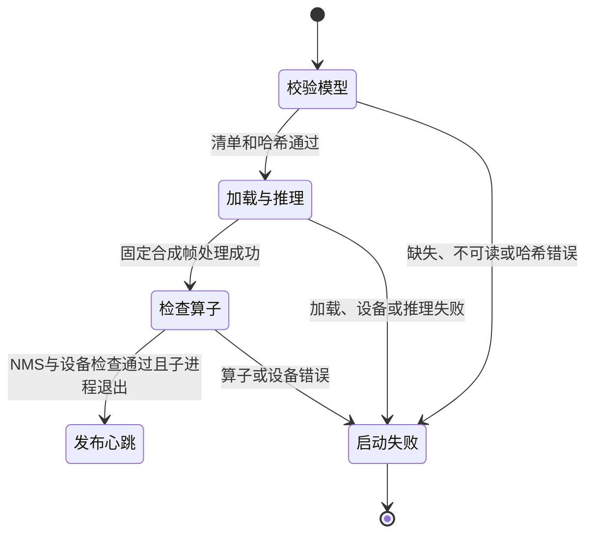

# 数据与生命周期：服务器 CPU/GPU 部署

本功能不新增数据库实体、任务类型或 HTTP 字段，沿用现有 Redis 任务记录、队列、租约及媒体目录。下列对象是部署与验收数据，具体配置见 [部署契约](contracts/deployment.md)。

## 部署配置

| 字段 | 约束与关系 |
| --- | --- |
| 部署标识 | 固定 Compose 项目名 `vision-shield`；两种模式使用同一标识和数据位置 |
| 设备模式 | CPU 或单卡 CUDA；与 `DETECTION_BACKEND` 独立，默认策略仍为 `quality` |
| GPU 标识 | GPU 模式必填一个卡号或 UUID；两类 worker 选择同一设备，不传 `all` 或逗号分隔列表 |
| 模型位置 | 宿主绝对目录，只读挂到两个 worker 的 `/models`；关联两份模型清单 |
| 媒体位置 | 宿主绝对目录，在 API、文件 worker、流 worker 内统一为 `/data` |
| 状态位置 | Redis 命名卷；保留 AOF、always 与 noeviction，不与临时容器生命周期绑定 |
| 内部地址 | Redis、MediaMTX 控制、RTSP 推流和发布鉴权使用容器服务名 |
| 外部地址 | API 监听地址与调用方可达的 RTSP 播放地址，由部署人员填写 |

宿主 GPU 选择限制容器可见设备；容器内使用既有 `cuda`，不将宿主卡号直接传成 `cuda:N`。设备选择不代表显卡独占。

## 离线模型包

复用 `models/manifest.json`、`models/cpu-manifest.json`，不另造模型身份格式。

| 角色 | 默认文件 | SHA-256 |
| --- | --- | --- |
| EgoBlur 人脸 | `face.jit` | `6eb2f6eb51fd1193d29b048aa7d1750a74fc5673d6e803231e25501cbf51567c` |
| EgoBlur 车牌 | `license_plate.jit` | `d0be72e015e30f0123a9194419bbb2fdcb6916faf81096e3fa2b50bcd1a85ade` |
| YuNet 人脸 | `yunet_face.onnx` | `8f2383e4dd3cfbb4553ea8718107fc0423210dc964f9f4280604804ed2552fa4` |
| HyperLPR 车牌 | `hyperlpr_plate.onnx` | `2a985dc63a5cc947ec36d18503d6fc0fd54525b9dba17f2fe29a71e86b44456d` |

四份权重合计 842,516,699 字节；同时提供两份清单、`README.md`、`NOTICE.md` 和 `licenses/`。清单保存来源、revision、许可及哈希；原始 zip 不是运行必需品，权重与压缩包不进入 Git 或应用镜像。实施时补齐 NOTICE 中 EgoBlur 的来源与许可归属，复用已有 Apache-2.0 许可全文。

默认 quality 必须验证全部四份文件；既有轻量 cpu 后端仅验证两份 ONNX，egoblur 后端仅验证其两份 JIT。更换设备不更换模型包。哈希通过仅证明文件身份，仍须实际加载与推理。

## 启动预检报告

报告只写有限启动日志，不持久化到业务数据库，不增加任务状态。包含后端、请求设备、实际设备、torch/torchvision/CUDA 版本、模型校验结果及失败阶段；CUDA 另记录设备名称、计算能力和构建架构列表。不输出完整配置、凭据或原始媒体。

worker 监督的预检总超时 120 秒，超时终止并等待子进程。未完成预检不启动 Receiver、不登记 worker 心跳；干净首次启动时 ready 因此不可用。运行中 worker 崩溃后，旧心跳可能在默认 LEASE_SECONDS=20 秒内仍有效，过期后才反映为 ready 失败；正常退出主动撤心跳。预检通过不等同于效果或双 worker 容量通过。

## 任务与数据保留

- 保持现有 `queued`、`processing`、`succeeded`、`failed`、`cancelled`、`connecting`、`running`、`recovering`、`stopped` 状态与 `desired_state` 含义。
- 服务停机不写入用户的取消或停止意图。execute 须区分该进程内停止事件，回收未完成媒体后停止续租、跳过正常失败 finish，再按既有失租约流程成为 `failed/worker_lost`；持续流在原 `desired_state=run` 下恢复。显式取消和停止仍等待资源回收完成。
- 正常重建容器、切换 CPU/GPU 或 `down` 不删除模型目录、媒体目录或 Redis 卷；已经成功的结果仍可查询和下载。在途半成品不能作为成功结果。

## 验收记录

每次验收保存独立目录，记录代码版本与镜像 digest、模式及 GPU 标识、硬件和依赖版本、模型与输入哈希、尺寸、并发数、检测参数、任务 ID、状态和输出位置。分别记录端到端耗时、模型加载与处理耗时；视频/流再记录帧数、处理帧率、丢帧和观察时长。人工核对漏遮、误遮及模式差异，不要求不同设备逐像素相同。
