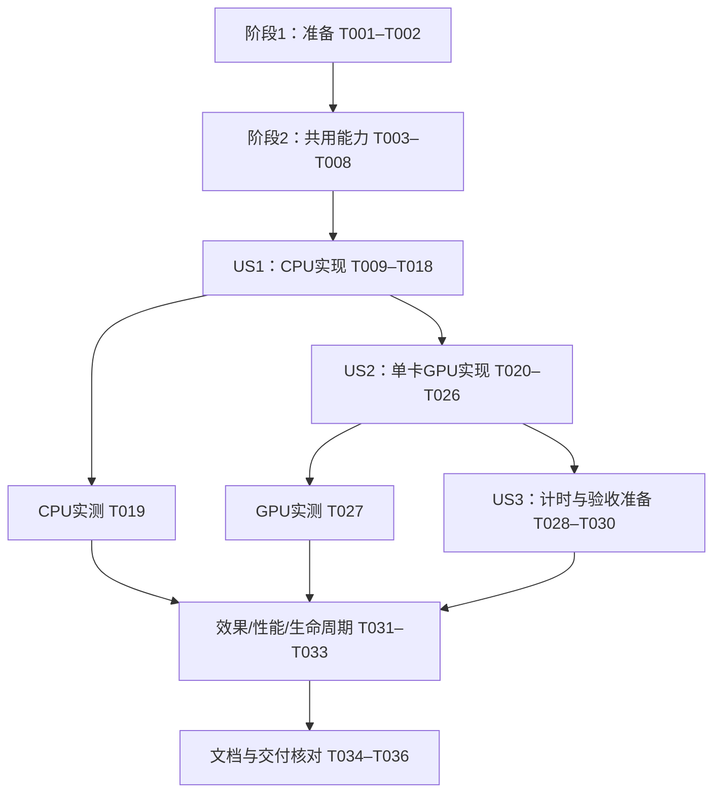

# 任务清单：服务器 CPU/GPU 部署与离线模型

**生成日期**：2026-10-19

**输入**：[规格](spec.md)、[计划](plan.md)、[研究](research.md)、[数据与生命周期](data-model.md)、[部署契约](contracts/deployment.md)、[验收指南](quickstart.md)。

**前置条件**：需求已确认，研究与设计完成；目标为 Ubuntu 24.04.4 x86_64、RTX 6000 Ada、驱动 595.84、独立入口 docker-compose v2.29.2。GPU 模式指定一张卡供两类 worker 共用，不做多卡调度。

**测试依据**：规格明确要求可独立执行的验收场景，项目宪章要求非平凡逻辑和缺陷先有针对性测试。以下测试任务须先确认失败，再完成对应实现；复用现有测试，不复制推理算法建立测试替身。

**状态**：已完成 27/36 项本地实现与交付核对；T018、T019、T026、T027、T030–T033、T035 保留未完成。其中 T018/T026 仅有配置解析证据，T030 已有指南/表格，仍缺实际服务器素材哈希。用户选择在服务器执行命令，不在本机安装 Docker。详见 validation/gates.md；本机证据不作为目标容器或服务器验收。

## 格式与执行边界

- 每项采用 `- [ ] T001 [P?] [USn?] 描述与文件路径`，ID 按实际顺序递增。`[P]` 仅表示在已列前置完成后可与不同文件的任务并行，不表示自动派生代理或并行跑同机性能测试。
- 文件路径相对仓库根目录 `E:\workspace\python\hos-vision-shield`；未存在的目标文件由对应任务创建。`specs/002-compose-cpu-gpu/validation/` 中的报告只在执行对应验证时创建。
- 不新增数据库、业务 API、检测策略、阈值、模型格式、常驻模型服务或进程管理器。根 `pyproject.toml` / `uv.lock`、Windows 默认安装与运行约定保持。
- 真实模型、Redis/MediaMTX、Docker 和服务器验证显式执行；没有相应环境时保留任务未勾选，记录缺失条件并继续不依赖它的实现，不将模拟结果视为真实通过。
- 不默认连接或修改未提供访问方式的服务器，不自动改宿主驱动、Docker daemon 或其他业务。离线模型可独立打包，运行时不下载权重。

## 阶段 1：准备与构建边界

**目标**：记录当前回归基线，防止本机文件进入容器交付。

- [X] T001 核对 `src/vision_shield/config.py`、`jobs/worker.py`、`jobs/tasks.py`、`media/child.py`、`media/publisher.py` 的调用链与现有测试，运行不触发真实模型/服务的相关单元基线，将命令、结果、当前 Git 状态和未运行项记录到 `specs/002-compose-cpu-gpu/validation/gates.md`；不覆盖已有未提交工作。
- [X] T002 [P] 新建 `.dockerignore`，排除 `.git`、`.venv`、本机 `.env*`、媒体与授权样本、模型权重/zip、缓存和日志，保留应用源码、项目构建元数据及部署所需依赖锁；禁止将模型包或敏感配置复制进镜像。

## 阶段 2：共用前置能力

**目标**：先解决所有部署方式共用的地址与 Linux 生命周期问题；这些任务完成后再接入容器 worker。

### 先复现问题

- [X] T003 [P] 扩展 `tests/unit/test_config.py` 并新增 `tests/unit/test_publish_address.py`，验证内部 RTSP 地址的协议/凭据/查询校验、未配置时的原地址回落、Publisher 使用内部地址而业务响应保留公开播放地址；使用最小存储替身，不连接外部服务。
- [X] T004 [P] 在 `tests/unit/test_worker_shutdown.py` 与 `tests/integration/test_runner_lifecycle.py` 建立失败用例，覆盖 worker 停止事件、持续流占满 Receiver 槽位时可退出、加载中父管道 EOF、子进程卡住时的有界回收与事件循环响应；验证部署停机不伪造用户停止、不将未完成文件误报为 processing_failed 或成功。加载替身不要求真实权重。

### 实现与检查

- [X] T005 在 `src/vision_shield/config.py` 增加可选 `RTSP_PUBLISH_BASE_URL`，复用既有 URL 校验；在 `src/vision_shield/media/publisher.py` 优先使用该地址，未设置时回落公开地址；不改变 `api/routes.py`、`api/schemas.py` 对外契约。前置：T003。
- [X] T006 在 `src/vision_shield/jobs/worker.py`、`jobs/tasks.py`、`jobs/reconcile.py` 接入 POSIX SIGTERM/SIGINT 与既有 broker.state 中的进程内停止事件：停止接单、触发媒体回收、撤销自身心跳并关闭 broker；execute 区分部署停机和用户停止，回收后停止续租、跳过未完成文件的正常 finish，保留失租约 worker_lost 与流恢复语义；已提交结果不改写，不清空整个 worker 池。前置：T004。
- [X] T007 [P] 调整 `src/vision_shield/media/child.py`，仅 Linux 在模型加载前启动父管道 EOF 监视，Windows 保留当前初始化顺序；沿用 `media/runner.py` 的停止命令、超时终止和 wait，不引入进程组或额外监督服务。前置：T004；可与 T005、T006 并行。
- [X] T008 运行 T003、T004 对应测试及 `tests/unit/test_media_errors.py`，确认用户取消、部署停机、正常结束和卡死回收均符合既有状态边界；在 `specs/002-compose-cpu-gpu/validation/gates.md` 记录平台与实际覆盖范围，Linux 信号证据不得由 Windows 模拟代替。前置：T005–T007。

**检查点**：地址行为与本机回落通过；进程停止设计已落地。Linux 实机信号与服务恢复仍由后续服务器任务完成。

## 阶段 3：用户故事 1 — 使用离线模型部署 CPU 服务（P1，MVP）

**目标**：无 GPU 分配也能通过完整六服务部署处理图片和视频，验证离线权重、错误就绪保护与数据保留。

**独立验收**：仅使用 CPU Compose，将同一四模型包只读挂载；在禁止外部模型来源访问后启动、上传图片/视频、查询和下载结果，再重建服务确认记录和结果保留。损坏或不可读模型不得发布新 worker 心跳。

### 先复现问题

- [X] T009 [P] [US1] 新增 `tests/unit/test_model_preflight.py`，验证 quality/cpu/egoblur 对应的模型角色选择、两份清单匹配、文件缺失/不可读/坏哈希/无法加载、真实推理函数抛错时明确失败；验证诊断只含文件/角色/阶段、不输出完整配置和凭据。使用临时文件及检测器替身。
- [X] T010 [P] [US1] 扩展 `tests/unit/test_worker_models.py`，验证成功事件与退出码均正常且子进程退出后才启动 Receiver/心跳；缺失成功事件、非零退出、120 秒总超时和启动中停止均不得登记心跳，且监督方回收 probe。使用可控时钟/子进程替身，不实际等待 120 秒。

### 实现与交付

- [X] T011 [US1] 新增 `src/vision_shield/detection/preflight.py`，按现有后端与模型路径复用 `models/manifest.json`、`models/cpu-manifest.json` 核验身份、读取权限和 SHA-256，再复用检测工厂处理固定 320×320 RGB 帧，并以非空框实际执行目标设备 NMS；提供 `python -m vision_shield.detection.preflight` 运维入口，输出有限结果，不连接 Redis/MediaMTX、不写业务媒体、不下载或回退。前置：T009。
- [X] T012 [US1] 在 `src/vision_shield/media/child.py` 增加仅内部 `kind=probe` 分支，复用 T011 并在成功/失败后退出；在模型校验与加载前已有 Linux EOF 保护，不创建业务任务目录、不经过 API 任务类型，也不重复加载检测器。前置：T007、T011。
- [X] T013 [US1] 在 `src/vision_shield/jobs/worker.py` 通过现有 `media/runner.py` 监督 probe，将清单读取、哈希、加载、推理均置于子进程的 120 秒总超时内；确认成功事件、退出码与资源释放后再启动 broker/Receiver/心跳，诊断失败明确且不泄漏配置，不在常驻 worker 导入 torch。前置：T006、T010、T012。
- [X] T014 [P] [US1] 更新 `models/README.md`、`models/NOTICE.md`，补齐 EgoBlur 来源与 Apache-2.0 归属、四份模型/两份清单/许可证的离线包说明与核验命令；复用既有许可全文，不重新选型、下载或提交模型权重。
- [X] T015 [P] [US1] 新建 `deploy/redis.compose.conf`、`deploy/mediamtx.compose.yml`，分别使用容器网络监听与正确数据目录、AOF always/noeviction，以及 RTSP TCP、内部控制、指向 api 服务的发布鉴权回调；保留禁止发布者覆盖与禁录像，不改本机 `deploy/redis.conf`、`deploy/mediamtx.yml`。
- [X] T016 [P] [US1] 新建 `deploy/Dockerfile` 的 CPU 应用镜像构建，默认 TORCH_BACKEND=cpu，固定研究记录中的 Python/uv digest 与 linux/amd64，按根 uv.lock 非编辑安装运行依赖和项目；运行用户 10001:10001、WORKDIR=/app、四条绝对模型路径=/models，运行入口直接 Python；不含权重、开发工具、uv 缓存或本机环境文件。GPU 构建由 T024 补齐。前置：T002。
- [X] T017 [US1] 新建 `compose.yaml`、`deploy/compose.env.example`，为四个应用服务显式设置 `image=vision-shield:cpu` 与 `build.args.TORCH_BACKEND=cpu`；实现六角色、统一 `/data` 媒体挂载、Redis 持久卷、worker 模型只读挂载且缺目录不自动创建、CPU 设备设置、来源 allowlist、可配置宿主绑定和公开播放地址；按契约设置依赖/ready、init 与 60 秒停止宽限，仅发布 API/RTSP，不因等待 API healthy 造成启动循环。前置：T005、T013、T015、T016。
- [ ] T018 [US1] 使用 `docker-compose v2.29.2` 实际解析 CPU 配置并构建 CPU 镜像，检查构建内容、用户/目录权限、av/cv2/torch/torchvision 导入、CPU 构建及 H.264/AAC 能力；依据实测缺库补最小运行依赖，将镜像 digest、命令及失败原因记录到 `specs/002-compose-cpu-gpu/validation/cpu.md`。不得把 YAML 文本解析当作 Compose 或镜像验证。前置：T009–T017 对应测试与实现完成。
- [ ] T019 [US1] 按 `specs/002-compose-cpu-gpu/quickstart.md` 在明确无 GPU 分配的容器环境执行模型无网络预检、CPU 六服务图片/视频上传下载、无外部模型下载、缺失/损坏/不可读/不可加载模型失败、停止重建后结果保留；记录到 `specs/002-compose-cpu-gpu/validation/cpu.md`，故障测试使用独立项目和模型副本，ready 考虑默认 20 秒旧心跳窗口。前置：T018；服务器运行任务。

**检查点**：T009–T018 形成 CPU 可部署交付；T019 通过才声明 CPU 实际验收通过。MVP 不依赖 GPU 镜像、GPU 运行时或 US3 的对比报告。

## 阶段 4：用户故事 2 — 在服务器选择 GPU 处理（P1）

**目标**：同一模型和策略下，显式选择单张 RTX 6000 Ada，文件与流 worker 共用它，失败不回退。

**独立验收**：使用 GPU 覆盖配置，实际验证唯一设备、模型和 CUDA NMS；至少一项文件任务及一项流任务在选定卡执行，另验证错误设备标识明确失败。CPU/GPU 切换不改源码或历史数据。

### 先复现问题

- [X] T020 [P] [US2] 扩展 `tests/unit/test_inference_device.py` 与显式启用的 `tests/integration/test_gpu_model_probe.py`，保留设备/策略独立及无 CUDA 失败断言，增加真实非空 CUDA NMS、模型实际设备与有限版本诊断检查；真实探针按配置模型目录核验四份权重，不要求生产镜像包含 pytest 或样本，保留 RUN_GPU_TESTS=1 开关。
- [X] T021 [P] [US2] 扩展 `tests/unit/test_model_preflight.py`，覆盖部署 GPU_DEVICE_ID 为单个卡号/完整 UUID、空值/all/列表非法、CUDA 不可用、可见卡数不为 1 或 NMS 失败时明确拒绝；未设置部署变量的本机 CPU/GPU 行为保持，不把宿主卡号作为容器 cuda:N。

### 实现与交付

- [X] T022 [P] [US2] 按 `specs/002-compose-cpu-gpu/research.md` 从根 pyproject.toml/uv.lock 导出共同约束，在临时目录生成并保存带哈希的 `deploy/requirements-cu126.txt`，固定 torch 2.14.1+cu126、torchvision 0.29.1+cu126，核对共同版本及 Linux/Python markers；增加 `tests/unit/test_deployment_dependencies.py` 的小型一致性检查，安装解析 dry-run 不覆盖本机环境，不改根依赖或人工维护第二份声明。
- [X] T023 [US2] 扩展 `src/vision_shield/detection/preflight.py`，在部署变量存在时校验单个设备标识与唯一 CUDA 可见设备，记录真实设备/能力/构建架构与模型/NMS 所在设备；CPU 镜像不可用 CUDA、非法标识、算子异常均明确失败，禁止换卡/回退，不新增 Settings 设备选项。前置：T020、T021。
- [X] T024 [US2] 在同一个 `deploy/Dockerfile` 增加 TORCH_BACKEND=cu126 构建分支：空环境一次同步 T022 的完整 GPU 锁，再无依赖安装同一应用；保持 CPU 分支、应用用户和路径一致，构建不要求 GPU，运行时不执行根 uv sync、不叠加 CUDA devel 镜像。前置：T016、T022。
- [X] T025 [US2] 新建 `compose.gpu.yaml`，只覆盖两类 worker 的 `image=vision-shield:cu126`、`build.args.TORCH_BACKEND=cu126`、INFERENCE_DEVICE=cuda、同一 GPU_DEVICE_ID 环境及单元素 device_ids；使用 capabilities:[gpu]、driver:nvidia，不设置 all/count 或 services.gpus，API/reconciler 继续使用 CPU 镜像及 `build.args.TORCH_BACKEND=cpu`，且不分配 GPU。前置：T017、T023、T024。
- [ ] T026 [US2] 用现有 `docker-compose v2.29.2` 分别解析基础与覆盖配置：基础配置四个应用服务的 `build.args.TORCH_BACKEND=cpu`；合并后两 worker 的镜像及参数分别为 `vision-shield:cu126`、`cu126`，API/reconciler 保持 CPU。构建两种镜像后，无需显卡分别断言 CPU 镜像的 `torch.version.cuda is None`、GPU 镜像的 `torch.version.cuda == "12.6"`；另确认部署变量缺失明确失败、两 worker 指定相同设备且控制端口不外泄。核对根依赖文件未变，将结果及 GPU 锁重生成命令记录到 `specs/002-compose-cpu-gpu/validation/gpu.md` 和 `README.md`。构建不执行需要实际显卡的断言。前置：T020–T025。
- [ ] T027 [US2] 在目标服务器核对 Engine/Toolkit 后，显式指定单张卡执行无网络模型探针、CUDA NMS、一项文件和一项流任务，核对两池实际设备；验证无效卡号/UUID及不可用 GPU 明确失败、不改用其他卡或 CPU，停止并切换模式后历史数据保留，记录真实版本、设备 UUID、进程与资源退出到 `specs/002-compose-cpu-gpu/validation/gpu.md`。前置：T026；服务器运行任务，具体卡号/UUID 为部署输入。

**检查点**：T020–T026 形成单卡 GPU 可部署交付；T027 通过才声明服务器 GPU 已可运行，仍不代表六组效果或性能验收完成。

## 阶段 5：用户故事 3 — 对比真实媒体效果与处理速度（P2）

**目标**：使用相同媒体、模型与参数留下 CPU/GPU 可复现的效果、耗时、播放及重启证据。

**独立验收**：两模式分别完成图片、视频和至少 60 秒 RTSP，共六组可查看输出；图片/视频各测一次首次与三次后续任务并报告中位数，完成客户端播放、停止、重启和人工核对。

### 测试与最小计时补充

- [X] T028 [P] [US3] 在 `tests/unit/test_media_errors.py` 与 `tests/unit/test_task_timing.py` 建立针对性用例，验证模型加载耗时通过内部事件/日志记录，既有任务 stats 的处理计时含义与响应字段不变；模型加载或推理失败不生成成功结果，诊断不输出源地址或配置凭据。使用受控时钟与最小替身，不跑真实模型。
- [X] T029 [US3] 在 `src/vision_shield/media/child.py` 记录每次业务子进程的模型加载耗时，并在 `src/vision_shield/jobs/tasks.py` 记录有限内部事件以关联 task ID/代次；保留既有处理阶段 stats，端到端耗时由调用侧测量，不增加 HTTP 字段、常驻模型或新的测量框架。前置：T028、T012、T023。

### 验收准备与执行

- [ ] T030 [US3] 完善 `specs/002-compose-cpu-gpu/quickstart.md` 的实际构建/启动/切换/查询/播放/停止命令与计时日志位置，核对离线包、来源 allowlist、模型目录及客户端地址；在 `specs/002-compose-cpu-gpu/validation/effects.md` 建立验收记录并关联固定授权图片/视频/重复 RTSP 源的哈希、目标区域与人工核对方式，不提交原始敏感媒体。前置：T017、T025、T029。
- [ ] T031 [US3] 按 `specs/002-compose-cpu-gpu/quickstart.md` 分别执行 CPU/GPU 图片、完整验证视频、持续至少 60 秒的 RTSP，下载结果并从允许网络的客户端实际播放；在 `specs/002-compose-cpu-gpu/validation/effects.md` 保存六组输出引用与漏遮/误遮/设备间差异，确认停止后任务和媒体会话结束，不要求逐像素一致或宣称零漏检。前置：T019、T027、T030；服务器运行任务。
- [ ] T032 [US3] 在同一服务器按相同素材、参数、并发条件分别测量两模式图片/视频的一次首次和至少三次后续任务，记录端到端、模型加载和处理耗时与后续中位数；流记录至少 60 秒的帧率/丢帧，另测两池同时工作时的 CPU/内存及所选卡峰值显存，将条件和结果写入 `specs/002-compose-cpu-gpu/validation/performance.md`。前置：T031；与其他效果/性能负载串行，不将后续任务称作热模型。
- [ ] T033 [US3] 按 `specs/002-compose-cpu-gpu/quickstart.md` 对 CPU/GPU 各执行持久化重建、显式流停止和 worker SIGTERM/重启，补充加载中父进程退出与强制终止、源流中断恢复的 Linux 证据；确认成功结果保留、在途文件 worker_lost、run 流可恢复而 stopped 不复活、会话/进程/显存释放和租约窗口内的 ready 行为，将结果写入 `specs/002-compose-cpu-gpu/validation/lifecycle.md`。前置：T031；保持同一数据位置，不执行 down -v。

**检查点**：六组效果、重复计时、指定单卡实际使用及两模式生命周期记录均具备实际证据；未执行或失败的场景保留未完成状态，不以配置检查或模型预检替代。

## 阶段 6：文档同步与交付核对

**目标**：让交付说明与实际实现、验证范围一致，保留既有 Windows 用法和未完成门槛。

- [X] T034 [P] 同步 `README.md`、`models/README.md`、`.env.example` 与 `specs/002-compose-cpu-gpu/quickstart.md`，说明离线模型准备、CPU/单卡 GPU 选择、内部/公开地址、端口与目录权限、停止和切换步骤、租约窗口与数据保留；保留 Windows 原生 CPU/GPU 默认安装及启动，不将服务器示例写入本机 .env。
- [ ] T035 运行与本次改动相关的单元和无外部服务的生命周期回归，并显式选择真实模型/服务/GPU测试；核对原有 Windows CPU/GPU 设备路径、质量策略与媒体状态契约未退化，在 `specs/002-compose-cpu-gpu/validation/gates.md` 分开记录模拟、真实模型、Compose 和服务器证据，不删除或跳过既有断言以伪造通过。
- [X] T036 核对 `specs/002-compose-cpu-gpu/spec.md`、`plan.md`、`tasks.md` 与所有实际交付文件，逐项复查 FR-001–FR-011、SC-001–SC-007 和宪章，运行差异/文档检查，更新 `specs/002-compose-cpu-gpu/validation/gates.md` 的交付状态；所有变更须能追溯需求，未执行的服务器任务仍未勾选，不自行提交或推送。

## 依赖与执行顺序

- 阶段 1 完成后开始共用能力；T003/T004 测试先于 T005–T007 实现，T008 汇总相关回归。
- US1 的预检链为 T009 → T011 → T012、T010 → T013；T013 还依赖 T012。模型说明、容器服务配置、CPU Dockerfile 可以按文件分开推进，最后汇入 T017/T018。
- US2 的设备测试先于 T023；T022 独立生成 GPU 锁，T024 依赖它，T025/T026 整合覆盖配置。US2 复用 US1 已完成的 CPU 交付；T019 服务器条件未具备时不阻止 T020–T026 的本地实现。
- US3 的 T028–T030 可在部署代码就绪后推进；T031 必须有 CPU/GPU 实际运行前置，T032/T033 共享服务器与数据，按顺序执行以免污染计时。
- T034/T035 可在相应实现就绪后开始；T036 只按真实证据汇总。服务器不可达时继续本地可执行工作，但不得将任何故事的服务器验收标记完成。

## 可并行的例子

| 范围 | 前置完成后可同时推进 | 必须串行的汇合点 |
| --- | --- | --- |
| 准备/共用 | T001 与 T002；T003 与 T004；T005、T006、T007 | T008 在共用实现后验证 |
| US1 | T009、T010、T014、T015、T016 分属不同文件 | T011 → T012 → T013，T017/T018 最后整合 |
| US2 | T020、T021、T022 分属不同测试与锁文件 | T023/T024 就绪后 T025 → T026 → T027 |
| US3 | T028 仅修改独立测试，可与已稳定部署代码的整理并行 | T029 改动 child/tasks，须等前一故事同文件改动完成；T031–T033 不并行压测 |

`[P]` 的前提是只修改各自列出的文件；若实际需要修改共同文件，先汇合前一任务再继续，不为并行新增抽象或复制代码。

## 实施策略与完成标准

1. **MVP**：阶段 1、阶段 2、US1。先交付 CPU 六服务与离线模型验证，T019 通过后可独立试用。
2. **单卡增量**：复用同一数据位置和模型包，完成 US2；指定 GPU、真实 NMS 与文件/流执行均通过后再报告 GPU 运行成功。
3. **效果对比**：完成 US3，留下六组输出、人工核对、重复计时与资源恢复证据，按实测说明差异与容量限制。
4. **交付复核**：完成阶段 6；所有代码日志、异常、注释和新增文档使用中文。真实权重/原始样本不入库，变更仅涉及本项目。

## 需求与验收覆盖

| 需求 | 主要实现与验证任务 |
| --- | --- |
| FR-001 完整 Compose 部署 | T015–T019、T024–T026、T034 |
| FR-002 设备选择独立于策略 | T016–T017、T020、T023–T027 |
| FR-003 CPU 无 GPU 要求、GPU 真实推理 | T011、T019–T020、T023–T027 |
| FR-004 离线模型身份与交付 | T002、T009、T011、T014、T017–T019 |
| FR-005 本地加载与就绪前检查 | T009–T013、T019、T023 |
| FR-006 失败不回退、不伪造成功 | T009–T013、T020–T021、T023、T027–T029 |
| FR-007 状态/结果/停止/恢复保留 | T004、T006–T008、T017、T019、T027、T033 |
| FR-008 地址、网络与来源限制 | T003、T005、T015、T017、T025–T026、T030–T031 |
| FR-009 可复现效果与性能验收 | T018–T019、T026–T033、T035 |
| FR-010 Windows 原生 CPU/GPU 保留 | T001、T003、T005、T007、T020–T023、T026、T034–T035 |
| FR-011 指定单卡供两池共用 | T021–T027、T032 |
| SC-001 CPU 图片/视频与模型零下载 | T019 |
| SC-002 六组媒体与 60 秒流记录 | T030–T031 |
| SC-003 四类错误明确失败 | T009–T013、T019、T021、T023、T027 |
| SC-004 首次/后续耗时、中位数与丢帧 | T028–T032 |
| SC-005 两模式重启、停止与资源释放 | T019、T027、T033 |
| SC-006 六组人工核对与差异 | T030–T031 |
| SC-007 两池实际选卡与无效标识 | T021、T023、T025、T027 |

## 生成检查

- 共 36 项：准备 2、共用前置 6、US1 11、US2 8、US3 6、交付核对 3；按相应阶段前置共有 14 项标记 `[P]`。
- 所有任务具有连续唯一 ID、按实际证据更新的勾选框和明确文件路径；故事阶段均使用对应 US 标签。
- 现有项目没有 `.specify/extensions.yml`，本轮没有 before_tasks/after_tasks 钩子需要执行；不修改已通过的规格检查项。
- 本轮已执行本地实现、针对性回归与真实 CPU/本机 GPU 模型验证；目标镜像及服务器运行由用户执行，未执行项不勾选。
