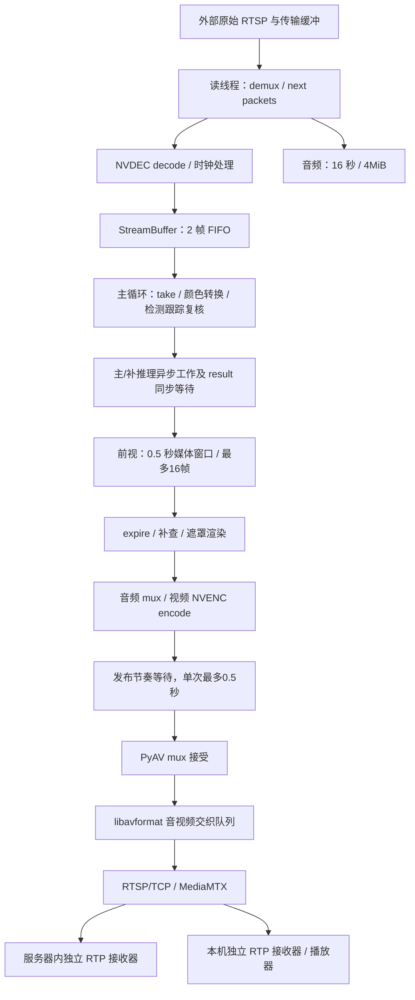

# 当前版本实时流卡顿根因诊断：第一轮

日期：2026-10-29（UTC+8）。原任务：`3c66326a-fd00-4fc8-9e99-9af23fbe45b7`。原始输入：`rtsp://192.168.1.104:8555/replay/rfm-01`。

## 结论与交付状态

本轮确认了两项主要问题：

1. **输出音视频交织缓冲会在 mux 已经接受视频帧后继续扣留数据，新增秒级无视频到达和成批释放。** 默认设置 A、仅将交织上限设为 100ms 的 B、恢复默认 A，内部接收端超过 500ms 的间隔分别为每千次有效间隔 **36.24、3.68、36.27**。B 相对两个 A 均下降约 **89.8%**；恢复默认后现象重现。这是本轮连接内额外长冻结的首要已验证原因。
2. **当前串行主循环的持续服务能力不足，积压经输入背压转移到上游。** B 组仍在 239.64 秒墙钟内只推进 158.73 秒媒体时间，累计进度落后增加 **80.91 秒**；恢复 A 的长连接增加 **93.69 秒**。处理、前视释放、编码和发布节奏等待共用主线程。复用缓冲改小不能解决这一项。

独立原流接收自身也存在约 3 秒停顿。没有证据将本次主要问题指定为旧的人脸复核长尾；已验证当前复核人脸确实使用优化后的 CUDA 会话配置。本轮没有修改模型、检测/跟踪规则、遮挡质量、前视补遮或媒体 PTS。

**临时 100ms 参数已撤回并部署恢复版本。** 本报告是诊断交付，不是修复完成或 G3/rfm 吞吐验收通过。

证据入口：[A/B/A 汇总](evidence/summary.json)、[逐次异常 CSV](evidence/stall-events.csv)、[逐帧时间线 CSV](evidence/frame-timeline.csv)、[可视化时间线](evidence/timeline.html)、[原始材料 SHA256 清单](evidence/raw-artifact-manifest.json)。保留了 13,809 条有效输出帧记录、2,381 个超过 100ms 的内部接收异常事件；连接切换另表统计。

## A. 当前真实执行链路

### 部署与运行审计

| 项目 | 服务器/API 证据 | 结论及边界 |
|---|---|---|
| 起点版本 | 首次授权部署输出显示旧检出 `e02593b`；随后部署诊断版本 | 没有把历史性能实验当作本轮运行证据；起点容器完整 Git 元数据未直接读取 |
| 诊断与实验版本 | 初始诊断 `db29f06`；内部接收 A=`266f14d`；100ms B=`dd3474e`；恢复 A=`77f98a9` | 实验只有 B 改动 RTSP 交织选项，其余新增内容为观测 |
| 实际源码 | A/B/恢复 A 的每个有效 attempt 均经 API 返回源码 SHA256，分别与对应 Git blob 的 **17 个模块全部一致** | 覆盖检测、跟踪/遮挡、前视、CUDA 帧转换、推流和诊断模块；不是整个容器文件系统审计 |
| 当前部署 | 授权部署脚本报告 `77f98a9`，容器健康；恢复 A 返回 `output_mux_options={rtsp_transport:tcp}` | 100ms 临时选项已撤回；不是只改本地代码 |
| main | `969f9f6`，相对部署版本只增加生产 DEBUG 边界测试 | 业务源码与恢复 A 相同；main 无生效的临时交织参数 |
| 人脸优化是否生效 | 复核 YuNet 会话 provider 为 CUDA，实际 `cudnn_conv_algo_search=DEFAULT`；源码哈希核对一致 | 已确认此前人脸修复配置生效，不沿用旧长尾结论 |
| 主要人脸模型 | YOLO face，CUDAExecutionProvider，ONNX 输入 `tensor(float)` | 权重 SHA256 见下表 |
| 主要车牌模型 | EgoBlur，参数位于 `cuda:0`、`torch.float16` | 已确认当前半精度路径；源码含现有异步设备转换，未切换历史实验路线 |
| 复核模型 | YuNet、HyperLPR，运行 provider 均为 CUDA | HyperLPR 所有运行张量精度没有单独采集，不据 provider 推断全部精度 |
| GPU/库 | RTX 6000 Ada，能力 8.9；Torch `2.14.1+cu126`，CUDA 12.6，ORT 1.20.2，cuDNN 91002，PyAV 19.0.1 | 完整库版本、provider options 和源码指纹见各组 runtime JSON |
| 任务生效参数 | `solid`，`3/flow`，输入帧缓存 2，音频 16 秒/4MiB，音频启用，发布节奏启用，码率上限 null | `effective_config` 为当前任务参数；运行元数据中 detector 默认 `mosaic` 不代表本任务遮挡方式 |
| DEBUG | 实际采样为 `debug=true, stream_diagnostics=true` | 未擅自修改服务器 DEBUG 环境；生产关闭 DEBUG 时不启用通用采样 |
| 输入格式 | 独立接收：H.264，640×480，average_rate=25/1，base_rate=50/1，time_base=1/90000；音频 AAC、8kHz、1024 samples | 不能用声明的 25 FPS 证明输入连续；AAC 单包约 128ms，音视频供包并不等间隔 |
| 主机资源 | API 暴露 worker cgroup 与绑定显卡快照 | 没有 SSH 进程、宿主任务列表、原生阻塞栈或整机调度证据，不能称已完成这几项审计 |

模型权重 SHA256：

| 模型 | SHA256 |
|---|---|
| YOLO face | `2e7af8694e93862be6a81c13b197ef766e8ab7e10af230bc19bc94d045dedb2b` |
| EgoBlur plate | `d0be72e015e30f0123a9194419bbb2fdcb6916faf81096e3fa2b50bcd1a85ade` |
| YuNet face | `8f2383e4dd3cfbb4553ea8718107fc0423210dc964f9f4280604804ed2552fa4` |
| HyperLPR plate | `2a985dc63a5cc947ec36d18503d6fc0fd54525b9dba17f2fe29a71e86b44456d` |

这些是运行 worker 返回的文件哈希，已与本地相应权重核对；不只是配置中的模型文件名。

### 线程、队列和阻塞点

主要阻塞关系：

- 读线程在 demux、解码、GPU 同步和满输入队列 `Condition.wait` 处可能等待。帧队列采用背压，无正常满队列丢帧策略；队列只有两帧不代表端到端积压只有两帧。
- 主线程在 `take`、检测/跟踪复核、future `.result()`、前视补查/渲染、编码、节奏 `stop.wait`、音视频 `writer.mux` 处可能等待。异步推理不等于整个发布流程异步。
- 前视等待窗口为 0.5 秒媒体时间、上限 16 帧；额外 wall deadline 为 0.75 秒，但只有主循环运行到 `expire` 才检查，因此它不是严格端到端时延上限。
- 音频超出时长/字节上限、无效时钟、尺寸变化和编码积压触发错误/恢复，不扩成无界应用缓存。编码待匹配保护上限 512。
- `mux` 返回与实际发 RTP 是两个位置。PyAV 19.0.1 的输出实现调用 `av_interleaved_write_frame`；FFmpeg 可等待各音轨都有包才输出，文档默认交织时间差上限为 10 秒。该值是媒体时间差，不是墙钟超时。未直接读取 C context 的默认数值。[PyAV 19.0.1 源码](https://github.com/PyAV-Org/PyAV/blob/v19.0.1/av/container/output.py#L694-L718)、[FFmpeg 格式选项](https://github.com/FFmpeg/FFmpeg/blob/master/doc/formats.texi#L135-L151)。
- 线程收尾、进程事件 stdout、Redis 状态传播及重连/重新排队也可能延后状态或恢复。没有把 API 健康时间当作视频包到达时间。

## B. 原流、处理与输出同步时间线

### 时间基与关联方式

输出帧使用 `attempt_id + sequence + source_pts` 标识，再以编码 VCL SHA256 和每个 RTP 连接的 90kHz 媒体时钟偏移进行匹配；重复哈希不能单独确定帧。三组服务器 worker 与 API 内接收器的 boot ID、时间命名空间偏移均一致，才比较它们的单调时钟。客户端的 `perf_counter` 只在客户端比较，未与服务器时钟相减。

`received_monotonic` 是 worker 从 PyAV demux 得到对应输入包后的采集时间，**不是网卡收包时间**。`encoded_monotonic` 是 mux 成功返回时间，**不是实际发包时间**。内部 RTP 接收是发布后可观测到达时间，不能代替精确发送探针。

### 四个真实严重事件

下表都是默认设置 A 中同一 attempt 内的相邻帧；单位 ms。原流列表示同一客户端时间窗内独立原流的最大到达间隔，不能据此认定是同一源帧的输入停顿。

| 事件/当前序号 | 源帧媒体间隔 | worker 读包间隔 | 处理开始间隔 | mux 完成间隔 | 内部 RTP 间隔 | 本机 RTP 间隔 | 同窗原流最大间隔 |
|---|---:|---:|---:|---:|---:|---:|---:|
| 735 / 103 | 40.00 | 24.36 | 40.06 | 33.73 | **3030.63** | 3007.28 | 1893.70 |
| 1055 / 1905 | 40.00 | 40.54 | 38.61 | 40.20 | **1810.59** | 1763.61 | 193.23 |
| 208 / 1197 | 40.00 | 39.73 | 37.66 | 40.47 | **1664.48** | 1658.97 | 161.41 |
| 828 / 607 | 40.00 | 40.11 | 39.93 | 40.11 | **1310.39** | 1296.39 | 141.66 |

例如事件 1055，源帧 `753227/9000` 已在服务器单调时钟 `5070083.4089734` 读到、`5070083.4095626` 解码完成、`5070083.5280319` 开始处理、`5070084.1575513` 被 mux 接受，直到 `5070085.981768175` 才被内部接收端收到。它与前一帧的 mux 接受间隔只有 40.20ms，接收间隔却达 1810.59ms。本机也观测到相同无视频到达，而同窗原流继续收到 45 帧，最大间隔 193.23ms。

事件 735 的客户端同窗内原流也有停顿，不能称“该时间原流完全正常”；但目标帧已完成 mux 后的额外等待仍有独立同帧证据。上述四次的完整 PTS、RTP timestamp、哈希及各阶段原始单调时钟见 [选定事件](evidence/selected-events.json)。

### A/B/A 最小实验

只改变 RTSP `max_interleave_delta=100000` 微秒，采样后恢复 `{"rtsp_transport":"tcp"}`。输入服务器、模型、跟踪、前视、PTS、码率及背景另一条原任务 `b21580fc…` 均保持。

| 分组 | 匹配帧数 | 有效相邻间隔数 | >500ms | >1000ms | >500ms/千次间隔 | 其中 mux 间隔<200ms 的严重事件 |
|---|---:|---:|---:|---:|---:|---:|
| A 默认 | 5714 | 5712 | 207 | 34 | 36.24 | 189 |
| B 100ms | 3804 | 3803 | 14 | 2 | 3.68 | 11 |
| A 恢复默认 | 4275 | 4273 | 155 | 27 | 36.27 | 140 |

三个窗口不是随机交叉、完全等内容的生产验收；输入循环内容及并发 GPU 负载仍有差异。处理耗时分布近似、B 后恢复重现、服务器内接收同样变化和隔离实验共同支持交织缓冲的因果归属。不能把 89.8% 当作所有场景最终收益。

本机真实 PyAV/RTSP 隔离实验保持 25fps 视频、故意让音频暂缺：默认与 `flush_packets=1` 的最大视频到达间隔均约 1080ms；交织上限 100ms 时为 160ms。三组均收到全部 100 帧，无错误。它说明仅刷新底层 I/O 不能消除交织等待，但不代替服务器结果。[实验结果](evidence/mux-repro-summary.json)

## C. 卡顿、队列和进度统计

### 输出间隔

单位 ms；内部接收是同帧匹配后的连接内间隔，mux 统计是程序接受输出；重连空窗不混入这些分位数。

| 位置/分组 | P50 | P95 | P99 | 最大 | >100 / >200 / >500 / >1000ms |
|---|---:|---:|---:|---:|---|
| 内部 RTP A | 0.25 | 430.92 | 859.93 | 3030.63 | 1118 / 690 / 207 / 34 |
| 内部 RTP B | 40.23 | 184.04 | 369.84 | 1711.17 | 563 / 154 / 14 / 2 |
| 内部 RTP 恢复 A | 0.23 | 434.55 | 849.78 | 2251.70 | 700 / 610 / 155 / 27 |
| mux 接受 A | 40.30 | 185.72 | 372.04 | 1010.84 | 829 / 245 / 28 / 1 |
| mux 接受 B | 40.30 | 172.61 | 316.30 | 811.35 | 493 / 135 / 11 / 0 |
| mux 接受恢复 A | 40.15 | 176.93 | 374.66 | 819.58 | 554 / 161 / 24 / 0 |

默认 A 的内部接收 P50 约 0.25ms 是成批到达，不能解释为“非常流畅”。mux 返回至内部接收延迟 P95：A 798.42ms、B 526.21ms、恢复 A 1263.01ms；最大分别 3019.60、1814.75、2699.25ms。100ms 交织参数不是端到端 100ms 上限。

独立原始流探针：A 窗口 10,025 个间隔，最大 **3020.77ms**，各阈值次数 **2510/105/28/13**；B 窗口最大 **3051.00ms**；恢复 A 最大 **3050.82ms**。原流各窗口均未见 RTP 序号缺口。原流与输出探针有效窗口长度不同，不直接比较累计次数。

### 单帧计算、前视与编码

逐帧计算口径为同一序号 `process + render` 的主机耗时，不含输入等待、前视驻留、额外前视补查、编码和发布节奏；不能称纯 GPU 推理时间。

| 分组 | 帧数 | P50 / P95 / P99 / 最大(ms) | >200ms / >500ms |
|---|---:|---|---|
| A | 5721 | 39.74 / 99.23 / 120.34 / 192.88 | 0 / 0 |
| B | 3813 | 37.17 / 97.96 / 122.73 / 317.78 | 3 / 0 |
| 恢复 A | 4275 | 38.58 / 97.76 / 122.90 / 381.88 | 3 / 0 |

A 的额外 `lookahead-push` 最大 508.54ms（1 次 >500ms），`lookahead-expire` 最大 230.73ms；恢复 A 分别为 377.73、224.54ms。A/B/恢复 A 未采到 >=100ms 的 video-mux 调用；注意 mux 调用短不代表数据已发出。视频 encode 的 >=100ms 样本 A 最大132.64ms、恢复 A 最大156.55ms；不是本轮秒级冻结的主要解释。

除 process/render 外，operation 只保留 >=100ms 的耗时，不能用这类有选择样本计算所有调用的 P50/P95。完整嵌套 stage 计时也不能相加。

### 队列与累积落后

| 项目 | A | B | 恢复 A |
|---|---|---|---|
| 输入队列 P50/P95/max | 2/2/2 | 2/2/2 | 2/2/2 |
| 满输入队列采样比例 | 97.7% | 100% | 97.6% |
| 前视队列 P50/P95/max | 11/13/16 | 11/13/16 | 11/13/16 |
| 最老输入读包年龄 P50/P95/max(s) | .230/.804/1.340 | .205/.754/1.138 | .239/.813/1.517 |
| 最老前视驻留 P50/P95/max(s) | .649/.841/1.020 | .595/.825/1.017 | .634/.810/1.178 |
| 采样到的编码待匹配帧最大数 | 0 | 0 | 0 |
| 音频应用队列最大字节数 | 13701 | 732 | 1774 |

最老输入年龄包含入队前背压，不是精确纯队列等待；CSV 的 decoded→process 也包含这一段。本轮没有独立的 enqueue 时间。前视年龄超过 .75 秒与主线程被占用后延迟检查相符，没有证据表明前视不按条件释放。

较长、连续的 attempt 进度如下。这里比较已归一为秒的**时间增量**，以 1 倍媒体速度计算落后增加量；不相减不同主机的绝对时间戳，也不声称测到了相机到播放器的总延迟。

| attempt / 分组 | 墙钟推进(s) | 媒体推进(s) | 进度落后新增(s) |
|---|---:|---:|---:|
| a059… / A | 240.18 | 162.60 | 77.57 |
| 412d… / A | 146.57 | 90.74 | 55.84 |
| f823… / B | 239.64 | 158.73 | 80.91 |
| 3b0e… / 恢复 A | 276.89 | 183.20 | 93.69 |

B 每秒墙钟约新增 .338 秒媒体进度落后。输入缓存没有增长，因为几乎一直满；背压会把未消费内容留在更上游。不能用应用队列长度稳定否定持续积压。

A 的一个 240.89 秒计数器窗口中，frame 处理/前视占用177.38秒，发布节奏等待53.75秒，encode口径4.44秒，source-backpressure236.06秒。前三项在当前串行循环占用相应位置；读线程背压与它们并行，不能相加。B 相应为173.07/56.83/5.12秒，背压236.48秒。这也说明没有依据把全部服务不足归到 GPU 模型。

当前较长窗口约需每帧63–68ms墙钟服务进度；25fps预算为40ms。保持当前输入内容、质量和工作量时，粗略需要整体容量达到约1.57–1.70倍，或把总服务占用减少约36–41%。这不是“GPU推理必须加速相同比例”的结论，也不是用平均FPS评估流畅性。

### 时钟、丢帧、重复及重连

- 有效帧记录在各 attempt 内均序号连续，采集序号缺口为0。查询到的 dropped/failed/unmatched/missing-receive 计数为0；不代表跨重连没有中断或最终停止时无未释放帧。
- A 有15条 timestamp repair、1次 source PTS 非递增；B和恢复A有效帧未见 repair。源媒体本身存在1.199/2.975/.784秒等跳变。原始包 PTS/DTS 的可用值保存在本机 AV 采集文件，RTP原始记录保留90kHz时间戳。
- A 有509个重复输出VCL哈希，恢复A有12个，B为0。静态内容、编码重复及循环素材都可能造成相同哈希，不能直接算成重复输出帧。未建立完整输入包哈希→输出帧链，视觉重复帧总数仍未确认；没有以重复帧提高统计吞吐。
- A 和恢复A各记录一次 `source_read/source_eof`，相邻 attempt 的 mux 无进展空窗为3.715秒和2.817秒。[重连记录](evidence/reconnections.json)。同窗独立原流接收未断开，不能据 EOF 错误码断定是原始服务器重启，具体断开机制待验证。
- 初版外部探针未发keepalive导致的约60秒断线已单独保存，未算作生产重连；部署启动、排队期间的接收404也未当作运行卡顿。

### CPU/GPU 资源

A 的流worker CPU采样P50/P95/max约144/248/278%，恢复A约159/252/274%，CPU上限80核；百分比以100%=1核。GPU是整卡口径，A P50/P95/max为46.5/74/84%，恢复A为68/83.1/86%。显存最大约7.58GB（全部三组），卡容量约51.5GB。

未显示整机CPU或显存饱和。整卡利用率不能排除某个执行流同步等待、局部CPU核瓶颈或其他任务竞争；没有原生等待栈/设备trace，因此这些子原因仍未确认。未在尚未归属的全程开启详细GPU profiling。

## D. 根因排序、确认范围与疑点

按本轮可量化的连接内新增冻结贡献排序；长期进度落后不能与冻结次数直接相加。

| 候选原因 | 证据及影响 | 频率/范围 | 状态及剩余疑点 |
|---|---|---|---|
| 音视频交织缓冲 | 同帧 mux 40ms而内部视频到达1–3秒；A/B/A参数单变量响应；隔离稀疏音频复现 | 默认A严重207次中189次mux间隔<200ms；恢复A155次中140次；B剩余11次 | **主要机制确认**。尚未读取原生交织队列，未逐次定位缺哪个音频包/具体音视频时间差；100ms也非最终生产验收值 |
| 串行处理/前视/发布服务不足 | 长连接媒体进度持续落后；输入队列近乎满，读线程大部分时间背压；B不消失 | 两组A和B持续存在，每秒约新增.32–.38秒进度落后 | **持续积压确认**。具体可减少的模型/跟踪/同步子项尚未隔离；发布等待是实测占用的一部分 |
| 原流供帧不连续及时间戳跳变 | 独立原流有约3秒无帧；RTP/媒体时钟有周期跳变 | A原流28次>500ms/10025间隔，三个窗口均出现 | **输入侧可见现象确认**，不归咎脱敏算法。源服务器/网络内部原因未审计；未完成所有事件的输入网络同帧映射 |
| 输入连接EOF与重新建立 | 两次source_eof及约2.8–3.7秒mux空窗 | A/恢复A各一次 | **中断确认，断开根因未确认**；与独立原流持续连接并存，不能只以相近时间归因 |
| 前视补查/计算单帧长尾 | A有一次前视push508ms；process+render最大<382ms | 少量亚秒事件 | 有局部贡献，**不足解释大多数秒级输出停顿**；未改变前视质量行为 |
| 旧人脸长尾、NVENC计算、GPU耗尽、纯播放器问题 | 人脸优化已生效；本轮无秒级单帧计算；编码长尾不足；内部RTP也停顿 | 未支持为主要原因 | **未确认为主要根因**。实际用户播放器接收/解码/渲染尚未采集，可能另有叠加因素 |

## E. 最小修复建议及后续验证

1. **首先只验证 RTSP 明确限制交织等待这一处修复。** 已验证候选是 `options={"rtsp_transport":"tcp","max_interleave_delta":"100000"}`，不改模型、帧或PTS。下一轮需补真实RTSP稀疏/暂停音频、时间戳跳变、音画同步和客户端播放回归，再确定生产值；不能将0误当低延迟值，FFmpeg文档中0意味着继续等所有流。当前main和部署均保持原设置。
2. **将持续积压作为独立问题处理。** 先针对主循环占用和必要同步等待做小范围反事实验证，保持同一输入、质量、前视和时间轴。只有证明发布等待与计算的可解耦收益后才决定线程/队列实现；暂不替换跟踪器、模型或扩大缓存，也不凭整卡利用率指定GPU优化。
3. 对 source_eof 使用同一输入连接的包级观测定位断开/恢复；在外部输入恢复后按源帧推进测量恢复迟滞。当前只能确认断开与进度落后，不能给出精确“原始同帧恢复到渲染”的时延。
4. 再执行双路长时验收：G3稳定有效输出≥15fps、rfm≥25fps，同时报告间隔分布、>500ms和>1000ms事件、累积落后、源帧对应、遮挡质量与回退。不能用平均值、重复帧、隐蔽丢帧或无界缓存验收。

### 观测开销与尚缺证据

通用诊断由 `DEBUG=true` 且 `STREAM_DIAGNOSTICS=true` 启用；环形记录128条操作/64条慢scope，独立事件<192KiB，每秒至多一次；内部接收256帧、每API进程最多2个、20秒无查询自动退出，不解码。外部采集单文件有容量上限；不新增GPU同步。局部空操作基准约7µs/operation、snapshot约0.4ms，仅说明本地函数开销，不是服务器严格同内容开/关验收。A/B/A采用相同观测，支持本轮参数因果比较；不能宣称观测完全无扰动。正式验收仍需关闭DEBUG复核。

未取得：网卡级实际输入/输出包时间、输入RTP→解码帧完整映射、每帧精确入队/出队时间、所有短调用独立encode开始结束、原生阻塞栈、GPU内核等待归因、宿主全任务清单、实际播放器缓冲和渲染事件。这些缺口已明确保留，未用不同时基或相近日志时间补成因果。

测试：通用诊断版本完整unit为894 passed、96 skipped；随后生产DEBUG边界及真实本地编解码相关测试122 passed、96 skipped。GPU条件测试未运行，未宣称完成生产性能/脱敏质量验收。

### 分支与恢复结果

- main=`969f9f6`：通用、有界、DEBUG控制的诊断及生产关闭验证；业务源码为恢复默认配置的版本。未重写已发布历史，也未清理无关历史代码。
- `feature/current-stream-stall-audit`：本报告、专项采集/分析脚本及精简后的结构化证据；不把这些专项材料合入main。
- `feature/rtsp-interleave-100ms`=`dd3474e`：保留可复现的100ms实验版本。部署已恢复`77f98a9`，未继续运行此参数。
- 原任务后来在16:38进入`stopped`，API记录`stop_requested`，记录本身不能归属发起者。按用户恢复要求创建替代任务；尝试旧发布路径收到401，已停止该失败尝试，未更改权限。最终恢复任务为 **`27c39007-0aee-4185-b8fa-9d1ece4de058`**，保留原`solid/3/flow`及音频，查询`running/ready`，本机实际解码20帧。
- 新播放地址：`rtsp://192.168.1.104:8554/redacted/27c39007-0aee-4185-b8fa-9d1ece4de058`；本机入口：`rtsp://127.0.0.1:18554/redacted/27c39007-0aee-4185-b8fa-9d1ece4de058`。恢复可播放不等于卡顿修复。

所有服务器状态读取均通过已授权HTTP API，流接收使用本机映射；远程仅使用既有精确部署命令，没有执行SSH诊断、调整远程权限或修改外部源。
