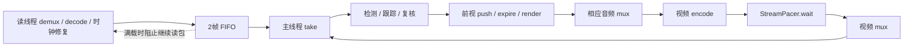

# 阶段二首轮：持续积压与发布节奏

日期：2026-10-29（UTC+8）。基线：`1c9be543c30fed7a2f4263b85c447ba079d438f8`。

## 结论与证据等级

1. **当前 100ms 版本仍持续积压。** 本轮 HTTP 实测的两个连接内，媒体每秒分别新增约 **0.319s、0.416s** 落后，输入 FIFO 满载采样比例 **99.1%、94.0%**。不是只有输出均值不佳。
2. **源码及本地反事实确认：迟到会抬高后续发布基准，串行执行把后续等待计入取帧服务时间。** 当前帧迟到时不会正向睡眠；此后的快帧可能仍在整条流落后的情况下等待。这两种“迟到”必须区分。仅取消迟到后的基准重设，能在确定性工作负载中改善推进，但不保证 25 FPS。
3. **计算/同步仍有独立缺口。** 当前两个窗口的处理/前视加编码分别约 **45.87、54.55ms/输出帧**。即使乐观地扣除全部发布等待、保持工作量不变，串行服务容量也仅约 **21.80、18.33 FPS**。达到 40ms 预算仍需减少约 **12.8%、26.7%** 非发布等待占用。这是计数器推导的乐观上界，不是已测修复收益。
4. **尚不能量化服务器可避免等待的准确次数/秒数。** 当前 API 没有逐次 due、剩余等待、重设原因；短于 100ms 的非 process/render 操作不保留，且滚动窗口有丢样。不能把本轮 56.07s / 24.45s 发布等待全部归为浪费。
5. **不建议现在直接重构发布线程或调整模型。** 本轮只修改专项采集/分析脚本，业务源码、配置、模型、PTS、前视及部署均未改变。以下 E0 是下一步最小观测方案；本轮没有准备或申请部署一个改变处理行为的候选。

## 基线与采样

- 任务：`27c39007-0aee-4185-b8fa-9d1ece4de058`；仅 GET 已授权 `http://127.0.0.1:18000` 任务、诊断、资源接口，没有 SSH、服务器 Shell、直接 RTSP 探查或任务变更。
- 窗口：**20:33:13.999–20:39:20.943**，约 366.94s，173 轮任务快照，HTTP 捕获错误 0。首次查询包含历史滚动帧；分析按各 attempt 的服务端采样边界过滤，不计入首批历史帧。
- 脚本旧版把“秒数”当轮数，HTTP 往返约 2s/轮。本次在约六分钟手工结束本地采集；保存的 JSONL 全部可解析。已补墙钟截止检查，后续最多再超出一轮请求时间，不能声称硬截止。
- 两个 attempt 的 **17 个运行源码 SHA256 均与固定基线 Git blob 一致**。Windows 工作副本 CRLF 不能直接与 Linux 文件 SHA256 比较。
- API 生效参数：100ms mux、`solid`、`3/flow`、保留音频、输入 FIFO=2、音频=16s/4MiB、pacing=true、DEBUG=true。只确认这些采集模块及参数，不据此推断整个容器 Git HEAD。
- worker 与内部接收器 boot ID、单调时钟 namespace offsets 一致。客户端单调时钟只用于采集时长，不与服务端时钟相减。

## 主循环与背压的实际关系



| 位置 | 已核查行为 | 含义 |
|---|---|---|
| `streams.py:112–125` | 满两帧时 `Condition.wait(.2)`，take 会 notify | .2s 是可被唤醒的轮询上限，不是每帧固定额外睡眠；应用 FIFO 有界，上游积压仍可增长 |
| `streams.py:233–267` | 同一读线程处理视频和音频；视频在入队前受背压 | 视频 FIFO 阻塞也会推迟后续音频 demux；不能只把音频供包不齐归给原流 |
| `streams.py:438–441` | 主循环先 expire，再 take；仅空队列时等待到最早前视期限 | 队列满时 take 不会再睡一个前视窗口；没有发现第二套独立的主循环发布限速 |
| `streams.py:494–497` | 检测后设 wall deadline=now+.75，再 push | 截止检查依赖主线程运行；不是独立定时释放或严格端到端 .75s 上限 |
| `plate_lookahead.py:32–60` | push 内可 expire；媒体跨度 .5s、容量16、场景切换可一次释放多帧 | push/expire 两个检查点本身不睡眠；提前释放会保留原有 discover 补查成本 |
| `streams.py:407–416` | `operation()` 完成整批 render 后，逐帧 write_output | 批量发布期间不会取下一输入帧；pacing、编码、音频 mux 均占用主线程 |
| `streams.py:327–349` | 视频编码后、视频 mux 前 pacing | encode 与 pacing 已分开计时；mux 返回仍不等于 RTP 到达 |

### 节奏规则：两个不同的发布时间目标

`stream_pacing.py:12–25` 的实际规则，设媒体帧间隔 `d=min(.5,max(0,PTS差))`：

```
due = max(previous_release + d, previous_actual + d/2)
if due < now - d/2:
    due = now
remaining = due - now
仅 remaining > 0 时 stop.wait(remaining)
```

`previous_release` 是计划时间，`previous_actual` 是等待完成后的实际时间。初始 epoch 并未永久保留；明显迟到会重设计划时间。正常定时器抖动继续沿旧计划推进，因此不能简单称其每帧累积全部计时抖动。

可复现例子：25 FPS，首帧在 0s；下一帧在 1s 才就绪。当前 due 早已过去，本次不睡眠，但把 previous_release 设为 1s。再下一帧 1.005s 就绪时，会等待到 1.040s，即 **35ms**；它相对最初媒体 epoch 的目标 .080s 已严重落后。单变量反事实保留旧 due，仍保留相邻至少 d/2 的约束，只等到 1.020s，即 **15ms**。这 20ms 差值来自重设规则；剩余 15ms 是该反事实仍保留的防突发策略，不能一起宣称无效。

首帧前视暖机、整批安全帧释放、编码扰动后平滑以及源 PTS 正常向前推进，确实需要某种有界发布节奏。不能删除所有等待。原始大 PTS 间隔会被等待上限截到 .5s，但 **PTS 本身没有被压平**；EOF/新 attempt 会重新构造 pacer、origin、AV clock 和前视队列，重置基准。视频时钟回退先走现有修复，pacer 接收的是编码包时钟，不能只用原始 source_pts 差推断其等待目标。

## 当前版本的实测缺口

| 指标 | `87ab176e…` | `77f9f0c2…` |
|---|---:|---:|
| 计数器窗口 s | 234.245 | 127.694 |
| mux 输出帧数 / FPS | 3764 / 16.07 | 1789 / 14.01 |
| 对齐首尾帧的墙钟 / 源媒体推进 s | 234.063 / 159.314 | 127.654 / 74.609 |
| 新增落后 s / 增长率 s/s | 74.748 / .319 | 53.045 / .416 |
| 输入队列满载采样比例 | 99.1% | 94.0% |
| source-backpressure 累计 s / 窗口比例 | 229.494 / 98.0% | 117.451 / 92.0% |
| frame：处理及前视占用 s | 167.785 | 95.034 |
| encode：扣除 pacing 后的音视频写出路径 s | 4.880 | 2.547 |
| pacing 累计 s | 56.075 | 24.447 |
| frame+encode ms/输出帧 | 45.87 | 54.55 |
| 非 pacing 容量乐观上界 FPS | 21.80 | 18.33 |

frame、encode、pacing 是主线程不同外层区间；不能再把 inference、track-recheck、local-confirm 等嵌套计时加到它们上面。source-backpressure 属于并发读线程，也不能与主线程相加。计数器边界可能含尚未发布的前视帧，短窗口尤需谨慎；上述窗口均超过两分钟，不把推导上界当精确性能预测。

当前主模型车牌 forward 的两个窗口累计分别 87.186 / 50.930s，复核车牌 forward 为 37.112 / 19.406s，track-recheck 为 46.430 / 31.695s，local-confirm 为 44.806 / 28.484s。它们有嵌套和异步重叠，只作为后续定位计算/同步边界的方向，不能相加或据此直接改模型。LK 的 track-flow 仅 1.619 / 1.047s，不支持默认从 LK 开始优化。

源 PTS 存在 .224、.334、.572、.784、1.199、2.975s 等正向跳变，详细事件见摘要。跳变会抬高按 PTS 计算的媒体推进量；即使如此仍有显著落后。当前输入的独立接收速率、精确输入 time_base 未由本轮 HTTP 新采到，不能用声明 25 FPS 替代实测原流到达。

输入最老读包年龄 P50/P95/max=.201/.730/1.252s；前视最老驻留=.645/.813/.919s。前者包含入队前背压，不能称纯 FIFO 等待。队列满载是采样比例，source-backpressure 是外层主机累计时间，尚缺精确 full-enter/exit、enqueue/dequeue 边界。

### 实际 RTP 到达

内部接收器观察到 **5558** 个图片到达事件、两个 RTSP 连接。整体接收有效速率约 **15.19 FPS**，包含此次重连空窗；首尾之间不足以证明完整音视频解码或视觉去重。

| 指标 | 结果 |
|---|---:|
| 连接内帧间隔 P50 / P95 / P99 / max ms | 40.14 / 211.77 / 457.10 / 2081.19 |
| 连接内 >500 / >1000ms | 41 / 5 |
| 固定1s窗口 FPS 最低 / 中位 | 0 / 13 |
| 固定5s窗口 FPS 最低 / 中位 | 3.6 / 12.6 |

1s/5s窗口从首个接收帧起分桶，包含跨连接空窗，舍弃不完整尾桶。接收序列没有采样缺口不等于底层 RTP 包序号没有缺口；现有内部接收器没有保存完整 RTP 序号、SSRC 或 AAC。这里不声称确认网络零丢包。mux 两个连接的 P99 为343.10 / 370.37ms，最大758.78 / 2082.55ms；它们与真实 RTP 到达分别统计。

## 最小本地反事实

实验直接导入基线 `StreamPacer` 和真实 `PlateLookahead`，使用确定性单调时钟。每组1200帧，原始25 FPS PTS、相同计算序列、相同前视 .5s/.75s/16帧、相同1ms编码写出模型。逐次等待目标/实际/等待量及释放批量保存在本地 JSON。没有运行模型、实际音频或 NVENC。

- **E1 仅改变迟到重设分支**：从实际类源码精确删除那一个 if 分支，保留 d/2 间隔下限和 .5s 等待上限；不改时间戳。脚本在该源码结构变化时拒绝静默继续。
- **E2 仅改变调度位置**：保持基线 pacer，使用离散事件模拟一个发布者及最多4个等待中的最终帧、另1个正在写出的帧。队列满则生产者等待，不丢帧；没有接入应用线程。

| 固定工作负载 | 当前串行 FPS / 落后增长 s/s | E1 FPS / 增长 | E2 FPS / 增长 |
|---|---:|---:|---:|
| 每帧5ms计算 | 25.00 / .000 | 25.00 / .000 | 25.00 / .000 |
| 循环90/10/10ms，平均36.7ms | 17.61 / .296 | 19.92 / .203 | 24.98 / .001 |
| 循环100/25/25ms，平均50ms | 16.64 / .334 | 18.69 / .252 | 20.04 / .198 |

E1 的36.7ms场景中，等待累计由23.446s降至15.546s；相对最初epoch落后超过一帧时仍正向等待801次/23.359s，反事实为800次/15.450s。它证明调度规则会放大持续积压，也证明不能用“整流已落后”作为删除全部等待的条件。E1正常25 FPS帧最小输出间隔仍至少20ms，非无限制加速。

E2说明等待与生产重叠存在调度收益，但不是实际 CUDA/音视频正确性证明。E2最终帧 ready→publish 最大约 .521–.581s，连既有原型的 .5s预算都可能超出，不能直接采用。保留真实前视对象不代表不同 wall deadline 路径下遮挡像素一致；模拟没有复杂场景、真实补查、音画同步、SSRC变化或设备内存生命周期验证。

另复跑既有 `004/experiments/final-queue-prototype.py`：4帧上限、生产者停顿仍发布存量安全帧、过期阻止输出、错误回传、满载背压四项自检通过。它仍是独立原型；不据此把应用的 write_output 放入线程池。

## 下一轮最小实验方案

**E0：先仅补观测，不改变任何节奏规则。** 需要本地准备独立候选并验证后，再给出固定 commit、覆盖范围及恢复 `1c9be543…` 的原部署命令，单独申请覆盖部署授权。本轮分析分支没有这些业务探针，不能把它当作 E0 候选部署。

| 观测点 | 必须保存的内容 | 用于区分 |
|---|---|---|
| 每次 pacer 决策 | attempt、输出帧身份、原PTS/time_base、修复后媒体秒、encoder PTS/time_base、origin、now、previous_due/actual、media_due、half_interval_due、选择后的due、remaining、rebase原因、实际wait起止、停止结果 | 已落后于当前due时误等、旧epoch已落后但重设后仍等、防突发下限、PTS跳变等待 |
| 输入队列 | 每帧decode/enqueue/dequeue时刻；满载进入/解除时刻、累计/当前阻塞、容量/占用；lock-held与Condition等待分开 | 纯队列等待、入队前背压、真正无输入 |
| 前视 | 进入时间、media/wall deadline、释放原因(media/wall/cap/reset/EOF)、释放批量、补查/反向补遮/最终render区间、下一次take时刻 | 必要未来窗口、迟检查、批量发布扣住主线程 |
| 主线程独占区间 | take、转换、检测/跟踪/复核父区间、前视独占计算、音频mux、encode、pacing、video mux、report；子区间用父ID记录并减嵌套区间的并集 | 计算、等待、同步与诊断传输开销的非重叠预算 |
| 时钟/生命周期边界 | raw/normalized两轨时钟与修复、PTS跳变、demux结束、decoder drain、flush、writer close、reader join、退避、下次source open/首帧/首输出 | PTS基准变化及EOF重建的实际空窗来源 |

探针应使用现有 DEBUG 门禁、主机单调时钟和有界元数据环，不增加逐算子 GPU synchronize，不保存原始画面。所有wait决策都进累计计数器；有限逐帧环必须报告首尾序号/淘汰数，采集读取覆盖不足就不能给“准确次数”结论。媒体缓存容量保持不变。补充环容量、事件字节上限和HTTP轮询间隔需先做本地负载验收；当前采集往返约2s，不能照搬128条操作环并宣称完整。

**E1：E0观测完整后，才做迟到重设单变量对照。** 保持音视频包、帧序、PTS、模型、遮罩与前视不变。覆盖正常25 FPS、抖动、场景切换、原始极短/大间隔PTS、回退修复、EOF、停止、慢encode/mux；实测音画映射、AAC完整性、输出间隔、进度落后斜率和前视补查。若输出速率或音频顺序异常，终止该候选实验，不自动部署/回滚。

**E2：最后评估发布线程。** 只在E0/E1的非重叠时间线证明收益后考虑正式实现；必须仅接收最终补遮完成的帧，帧数/显存/音频字节均有界，单写入者拥有音频、编码器、封装器和关闭生命周期，验证CUDA/DLPack存储、停止/失败/超时回传。当前实测frame单独也约44.58 / 53.12ms/输出帧，因此解耦本身不能保证实时。进一步定位计算/同步成本时只做测量，不先改人脸、车牌或LK，也不扩大缓存。

比较必须保持同源内容、PTS节奏、并发任务、DEBUG和接收器开销一致；先同内容本地重放，再逐个申请服务器候选覆盖实验。至少覆盖多个源内容循环/连接恢复，分别报告稳态和完整墙钟窗口。实时门槛不以某个短窗口均值替代：低FPS窗、队列等待趋势和媒体落后斜率都要改善，且保留音画和遮挡验收。

## AAC 时间轴：独立保留

- 用户阶段一结论：PyAV解码AAC PTS/DTS回退，直接RTP未见对应回退。本轮HTTP只有视频内部接收器，没有新增AAC/RTCP包证据；不把此前观察归因为100ms或播放器。本检出中阶段一原始AAC材料只有SHA256清单，清单指向的原始目录当前不在本检出，不能重新逐包核验。
- 本地 `tests/integration/test_rtsp_interleave.py` 和 `tests/rtsp_capture.py` 已有两配置下的AAC AU字节、RTP映射和RTCP SR音画关系断言。测试还明确固定素材在teardown时两配置均少一个最终AAC AU，不能称完美音频交付。本轮未重跑这些对照，也不拿它们代表当前真实流。
- 当前应用对RTSP AAC不解码，而是 `LiveAVClock.audio_packet` 修复读包时钟后转封装；RTMP非AAC才走转码。外部PyAV AAC解码观测和应用自身处理位置不同。还需分开记录解复用包PTS/DTS、AAC解码帧的可用时钟字段、sample_rate和samples，不能把包DTS与帧PTS混算。
- 下一步按**同一连接/SSRC与AAC AU字节哈希**对齐：保存SDP的payload type/clock rate/config、RTP序号和32位扩展时间戳、AU长度/索引、PLAY RTP-Info、RTCP SR的SSRC/NTP/RTP映射及CNAME/BYE、PyAV包和解码帧原始时基、连接重建标识。优先排除跨连接初始偏移、wrap、AU拆分和时基换算差异；不同接收连接的绝对PTS不能直接相减。
- 现有HTTP不足以提供这些证据；需要新观测入口时纳入独立候选授权。若需默认配置对照，先给具体时长、同源输入、恢复版本与回滚指令，再单独申请覆盖部署；当前100ms版本保持。

## EOF 与重连：独立保留

保留用户提供的阶段一 **3.365s、5.370s** 输出空窗。它们的原始记录不在本检出，不用仓库较早报告中的3.715s、2.817s替换，也不声称已复核前两项。

本轮新捕获正常 `source_read/source_eof`、returncode=0，mux空窗 **4.062928s**：

| 边界 | 服务端单调秒 / 间隔 |
|---|---:|
| 上个attempt最后mux | 5086139.586254 |
| 媒体函数结束 | 5086139.587337；距最后mux约1.08ms |
| 下个attempt开始 | 5086140.882071；距结束约1.295s |
| 下个attempt首mux | 5086143.649182；距开始约2.767s |

源码在 demux迭代StopIteration后设置buffer.eof；主线程消费/flush前视、flush编码器并退出，finally以source_eof记录正常结束。显式解码异常通常会走source_decode_error而非这个正常分支，但当前记录没有底层终止机制，不能由reason字段断定是源服务器主动关闭。

`jobs/tasks.py:192–207` 的attempt开始在来源校验、publisher准备及媒体执行之前；`tasks.py:299–301` 有1–30s退避。因此2.767s包含来源/发布准备、媒体初始化、首帧处理和前视暖机等，不能全部叫网络重连耗时；1.295s与首次退避相容，也不是已隔离的精确sleep时间。E0需要记录demux终止、解码flush、socket/RTSP关闭原因和每个重建边界，才能进一步归因；不预设外部源问题。

## 复跑与交付

```powershell
.venv/Scripts/python.exe specs/005-current-stream-stall/experiments/capture-live.py data/diagnostics/phase2-next 360 27c39007-0aee-4185-b8fa-9d1ece4de058
.venv/Scripts/python.exe specs/006-stream-backlog-pacing/experiments/analyze.py data/diagnostics/phase2-backlog-20261029 --assert-realtime
.venv/Scripts/python.exe specs/006-stream-backlog-pacing/experiments/counterfactual.py data/diagnostics/phase2-local-20261029
```

第二条已运行且预期返回1：`Sustained backlog: media progress falls behind by more than .05s per wall second`。`.05s/s`是本地反馈环的明显积压告警阈值，不是用户已批准的最终验收容忍度；最终仍以消除或显著改善持续积压及完整质量验收为准。分析器无flag时正常导出结果。

- [实测摘要](evidence/baseline-summary.json)、[反事实摘要](evidence/counterfactual-summary.json)、[原始材料清单](evidence/raw-artifact-manifest.json)。原始JSONL与逐次本地决策保留在`data/diagnostics/phase2-*`，不提交原画面或媒体。
- 76项现有 pacing、前视、音频时钟、调度和诊断单元测试通过；本地反事实及既有有界发布原型自检通过。没有业务逻辑修改，不部署、不推送、不合并main、不修改tag。
- **阶段二未通过验收。** 未消除实机积压；可避免等待的实机准确份额、无重叠GPU/同步归因、AAC、播放器缓冲与实际遮挡质量均仍需后续证据。
