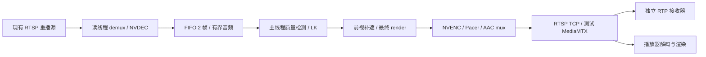

# my-server 实时卡顿修复

起点：`dd9f560a801d3bc2ab8e5fa3b194b20d81d02d59`。实验分支：`feature/my-server-live-stall`。
授权范围仅为 my-server 的独立测试栈，不访问 gpu-server，不修改重播推流器。

**最新已部署代码为 `ca2bb46d9346e88822f17aff1f9986aebc3297d0`，标签 `cand-20261104-myserver-numa-01`，DEBUG=false，三个测试 stream worker 已应用 NUMA node 2 配置。专项尚未完成。** 以下较早结果保留为历史对照；最新完整 600 秒复核见文末。第二路实际 RTP 输出约 22.14 FPS，仍持续积压，播放器和 25 FPS 验收尚未通过。

2026-11-04 已完成隔离 MPS、AAC 输入时钟修复和 NUMA 配置的各轮双流 600 秒复核，运行参数用 SHA256 固定。MPS 已纳入测试 Compose；NUMA 是追加的机器专用 Docker 配置，Compose 重建后须重新应用。正式栈配置不变，部署代码、配置试验及实际接收结果分别记录。

## 验证顺序

1. 固定真实部署与恢复资料，核对模块及 GPU 后端。
2. 同时接收 rfm-01/02 原流、完整脱敏输出，记录真实 RTP 完帧间隔、时间轴进度和播放器渲染。
3. 用隔离内部接收端运行无模型媒体链路，定位媒体成本。
4. 开启局部诊断，按主线程非重叠时间定位；单变量修复后复测，撤销无效修改。
5. 关闭诊断，验证持续积压、AAC/PTS/RTCP、遮挡与恢复；未完成项目明确记录。

## 初始部署（2026-11-03，UTC+8）

- 远端仓库：`/data/nvme1n1/zhanjh/hos-vision-shield-test`，HEAD 为起点提交；47 个已安装 Python 模块逐一与 Git blob 的 SHA256 一致。
- Python 3.12.15、PyTorch 2.14.1+cu130、CUDA 13.0、驱动 580.173.02；架构包含 sm_120，PyAV 19.0.1 / libavformat 63.1.102。
- quality_yolo：YOLO 人脸 + EgoBlur Gen1 车牌，YuNet/HyperLPR 补充；CUDA 推理，主车牌使用已有 FP16 路径。
- 项目绑定 GPU 4（UUID `GPU-ec9780c6-4e06-f44a-8491-e30f0ab74da9`），该卡也有其他进程。其他 7 张卡及其他服务不停止。
- 原有测试任务 `b30876a1-3c3f-4eaa-a3e6-90126ad6056e` / `08e5adc2-b8aa-4fce-9893-d8f8cc979d68` 分别使用 rfm-01/02；mosaic、interval=3、flow、5 Mbps、audio_enabled=false。此设置不能充当音视频验收。
- DEBUG=false，FIFO=2，前视 0.5 秒/16 帧及 0.75 秒 wall deadline；输出 100ms interleave，Pacer 已取消迟到重设。



## 恢复

初始状态、完整任务参数和源码指纹保存在服务器 `data/diagnostics/my-server-20261103/`；带私密字段的任务快照权限为 0600，不提交 Git。
原镜像已额外固定为 `vision-shield-test:baseline-20261103-cpu` 和 `vision-shield-test:baseline-20261103-cu130`，后续构建不会覆盖这些名称。
原 `.env.compose.test` 在更改前备份；恢复时还原该文件和起点提交，通过现有 Compose 测试栈入口恢复，或将上述固定镜像重新标记为 `vision-shield-test:cpu/cu130` 后 `up -d --no-build`。

原始视频、包载荷及凭据不提交 Git。mux 返回、RTP 完帧和播放器渲染分别计量，不互相替代。

## 已确认并修复

| 原因 | 独立证据 | 修复 |
|---|---|---|
| 单卡主模型与补充模型的交错执行增加关键路径等待 | 同内容 400 帧实际 RTP 对照：交错 42.544 s、串行 20.264 s；400 帧均收到 | 删除质量检测器的单 worker 主模型线程池，在调用线程按顺序执行；detail 内部脸/牌调度保持原样 |
| Gen1 backbone 的大量小算子提交成本 | 单次诊断中 1695 个 kernel，kernel 总计约 6.53 ms；1575 次 launch 在 profiler 下约 16.08 ms。此诊断不作为 FPS 验收 | 固定形状 backbone 用 CUDA Graph 重放；动态 proposals、NMS、阈值、模型权重不变；缓存最多两种形状，其他形状保留原路径 |
| RTSP 的 100 ms 交织限制按媒体 DTS 判断 | 原流部分连续包仅递增 5～6 个 90 kHz tick；同帧已 mux 后仍滞留 2.414 s | 降低 RTSP 交织阈值，并在每个视频包 mux 后释放已接受的交织包；保持单一 mux owner |
| 原版 PyAV 无显式交织 flush 接口 | 模型暂停 750 ms 时，已完成画面到真实 RTP 的等待达到约 791 ms | 测试 Docker 给固定 PyAV 19.0.1 增加 `flush_mux()`，调用 FFmpeg 的 NULL-packet interleaver flush，保留其异常、超时、关闭保护。按官方配置用 Cython 3.3.0 完整重建绑定，FFmpeg 9.0.2 库不更换 |
| MediaMTX 默认以接收时间替换媒体绝对时间 | 积压时 SR 映射产生数秒变化 | 测试栈启用 `useAbsoluteTimestamp`，保留发送端映射 |
| 保留真实 SR 后，gortsplib 对延迟媒体外推加入时 RTP-Info | 新加入的 FFmpeg 客户端出现视频约 47661 s、音频约 536810 s 的初始时间 | 仅对与 wall time 相差超过 1 s 的媒体省略推测的 RTP-Info 时间戳；包的 RTP/PTS/SR 不变 |
| 健康输出后输入中断仍固定等一次重试 | worker 源码和重试测试 | 已持续确认输出的 source_read/source_decode 中断立即重试一次；未健康、发布错误及连续失败仍指数退避 |

普通 Docker 构建仍选择原 `runtime`，只有 `compose.test.yaml` 选择含 PyAV 补丁的 `rtsp-test`。原版 PyAV 仍能运行 1 μs 的有界交织路径；完整显式 flush 需要测试镜像。

## 独立对照（已完成部分）

- 无模型媒体控制只向容器 loopback 的内部 RTSP peer 发送，保留解码、前视、编码、AAC 和真实 RTP 接收，未公开发布未脱敏画面。
- CUDA Graph 的同内容 400 帧 RTSP 对照：原路径 52.005 s，候选 36.291 s；输入 VCL 顺序一致，400 个实际 RTP 视频帧全部收到。仍有明显吞吐缺口，不能据此宣布 25 FPS 达标。
- 压缩 PTS 的真实 RTP 回归：100 ms 控制最大间隔 1.062 s，1 μs 路径 0.094 s；各 100 帧且保留原 PTS，已收到的 AAC 载荷逐包一致。
- 模型暂停的真实 RTP 回归：已完成画面的 mux→接收等待从 790.9 ms 降到 0.45 ms；模型本身暂停期间仍会缺少新画面，不将这段等待伪装成已解决。
- 线上完整重采 `flush-confirmation`：1617 个视频 access-unit 哈希逐一关联到主线程、容器出口和独立接收器。mux 开始→出口 P99 **0.944 ms**、max **1.626 ms**；mux 返回→出口 P99 **0.090 ms**、max **1.282 ms**；出口→接收 P99 **1.825 ms**、max **5.359 ms**。修复前同帧 mux 返回→出口 P99 约 **1.976 s**、max **2.414 s**。
- 此次 180 s 的独立输出共收到 2480 帧，间隔 >200/500/1000 ms 为 152/14/1；原流为 4317 帧、15/12/6。两条链路内容存在积压时移，此表是窗口观测，不把两条同时 wall-time 曲线当成同内容因果对照。

## 质量和完整性

rfm-01 的 2208 帧、rfm-02 的 2230 帧：新旧模型路径的脱敏 YUV 与 PTS 逐帧一致，各含 22 次主动制造的不完整前视释放及 EOF 尾部。完整 PyAV 重建后重新测试，两个视频的最终序列 digest 也与重建前完全一致。没有更改脸/牌阈值、覆盖、目标身份、LK 或前视窗口。

19 项实际 RTSP/AAC 回归通过，另有本地单元测试；具体结果及最终长时间测试在验收记录中补齐。两个独立控制都确认既有问题：RTSP 关闭时最后一个 AAC AU 没有发出（8000 Hz、1024 样本，即 128 ms）。已收到的连续前缀完整且逐包一致，**不把该缺口称为 AAC 完整性通过**。

## 当前尚未通过的门槛

串行修复后持续处理能力仍低于源的健康供帧速率。共享 GPU 4 的双流正式复核见下表；按用户选择继续使用该卡，没有停止其他任务。局部诊断中 653 个同帧匹配的源接收→应用解码延迟为 46.8～58.4 s，积压尚未解决。源媒体服务器已有慢读丢帧和超时证据；应用 `dropped_frames=0` 不证明源端到播放器无丢帧。

两形状图缓存的辅助 RTSP 统计为 823 次 hit、2 次 capture、58 次 eager 回退；回退约占 6.6%，没有扩大缓存掩盖瓶颈。单线程实验无稳定收益，未保留。同帧 detail 复用早期版本已撤销；在 graph+flush 后重测有小幅收益，尚未作为已验收修复合入。

正式复核使用 DEBUG=false，并分别保留真实 RTP、RTCP、worker 资源及 FFplay 的 A-V、队列和 fd 状态。FFplay 实际窗口单独观察；状态时钟不是逐帧渲染计数，RTP 到达不替代成功显示。

## 无效实验和证据边界

- 单模块 PyAV 扩展通过两个小测试后，在全量回归中崩溃；从未部署。改为官方 Cython 版本、limited API、共享 Cython 模块及完整绑定重建，19 项回归与实际 GPU 链路通过。
- JIT freeze、ORT CUDA Graph、显式 ORT stream、不同卷积算法、单线程和 GPU 调整没有足够收益，或产生数值变化，没有保留。
- 部分早期辅助硬解实验使用了与该驱动不兼容的单卡容器映射；失败样本不用于吞吐收益。后续与正式栈一致使用 all 映射及显式 CUDA UUID。
- 第一轮 `flush-diagnostic` 的大部分诊断响应超过采集器 512 KiB 预算，只有 97 个完整同帧匹配。`flush-confirmation` 将响应预算限定为 2 MiB，并只保留最近四个 attempt，重新完整采集；不把前轮缺口算成通过。
- 旧版 `wire-fixed-*` 是用户态 sniffer 时间，不能用于精确计算单向网络时延。最终同帧使用内核 `SO_TIMESTAMPNS`，并限制在同一主机时钟身份。

## 构建源码缓存

该机直连 Go 代理及大源码归档曾超时，`.env.compose.test` 使用可达的 Go 代理和 loopback 上的已校验 FFmpeg 归档。归档 SHA256 为 `6e374ed621e48faa40639307dff48ba6fe574a509977956d2cce9669b7cc27e9`，Docker ADD 仍强制校验；最终链接的 FFmpeg 库来自原 PyAV wheel。

loopback 缓存目录是服务器 `data/diagnostics/my-server-20261103/build-source-cache/`，端口及 PID 在其中的 `server.json`。需要重建且缓存服务已退出时，可在该目录用标准库 `python3 -m http.server <原端口> --bind 127.0.0.1 --directory <该绝对目录>` 恢复服务，再使用原部署入口。移除 `FFMPEG_SOURCE_URL` 即回到官方源 URL。回退不需要此构建缓存，可直接使用初始固定镜像。

参考：[FFmpeg 交织队列](https://github.com/FFmpeg/FFmpeg/blob/master/libavformat/mux.c)、[AAC RTP 封装](https://github.com/FFmpeg/FFmpeg/blob/master/libavformat/rtpenc_aac.c)、[MediaMTX 绝对时间](https://github.com/bluenviron/mediamtx/blob/main/docs/2-features/15-absolute-timestamps.md)、[固定 gortsplib RTP-Info 实现](https://github.com/bluenviron/gortsplib/blob/v5.6.7/server_stream_format.go)、[PyAV 官方构建配置](https://github.com/PyAV-Org/PyAV/blob/v19.0.1/setup.py)。

## 本轮 600 秒双流复核（2026-11-03，UTC+8）

按用户要求，从**首次启动时间累计 600 秒**，没有重新计时。原先的 1800 秒进程由额外的绝对截止控制器收紧，停止前验证 PID 和命令身份，只结束本轮采集器及播放器。原记录和失败日志均保留。

| 项目 | 实际开始 | 实际停止 / 最后样本 | 覆盖 |
|---|---|---|---|
| 本轮统一周期 | 16:18:50.544 | 截止 16:28:50.544；服务器完成停止 16:28:50.591 | 600 秒，停止动作晚约 47 ms |
| 两路原始/脱敏 RTP 接收 | 16:22:09.150 | 截止同上 | 401.394 秒；首次启动缺少 PYTHONPATH，未产生有效 RTP 样本 |
| FFplay | 16:22:20.129 | 最后状态 16:28:50.517；关闭 16:28:51.131 | 有效日志约 390.389 秒；初次启动误用 Windows Python 别名 |
| 主资源采集 | 16:18:50.626 | 最后样本 16:28:45.897；16:28:50.591 停止 | 120 个 5 秒采样点，采集进程覆盖统一周期 |

**不能将本轮称为完整的 10 分钟 RTP 或播放器观测。** 起始约 199 秒的 RTP 缺口不计为流冻结，也没有通过补测延长截止时间。

部署代码为 `4de6dd939d47a20756650964aabaac529b974356`，标签 `cand-20261103-myserver-serial-02`，DEBUG=false。API 与三个 stream worker 的 48 个已安装 Python 模块均与该提交逐项 SHA256 一致；原生 PyAV 输出模块 SHA256 为 `df08bff3a5286db1d07155eb4bbcabca640fe94211e8b5d47bc380ca8e7f0672`，实际存在 `flush_mux()`。

| 接收流 | 视频帧 | 平均 FPS | 间隔 P50 / P95 / P99 / max（ms） | >200 / 500 / 1000 ms | 1 秒 / 5 秒窗口 FPS 中位数 |
|---|---:|---:|---|---|---|
| rfm-01 原始 | 9699 | 24.16 | 0.225 / 159.73 / 161.31 / 3021.19 | 29 / 25 / 13 | 25 / 24.8 |
| rfm-01 脱敏 | 7353 | 18.32 | 25.91 / 168.64 / 325.05 / 8006.18 | 268 / 23 / 1 | 14 / 13.4 |
| rfm-02 原始 | 9981 | 24.87 | 0.230 / 160.39 / 161.40 / 886.41 | 18 / 13 / 0 | 25 / 24.8 |
| rfm-02 脱敏 | 5574 | 13.89 | 54.41 / 181.35 / 289.57 / 8390.98 | 209 / 9 / 2 | 13 / 12.4 |

平均 FPS 的分母为统一有效 RTP 观测窗 401.394 秒；窗口 FPS 每 100 ms 滑动，包含该有效观测窗内的恢复空窗。两路脱敏的 1 秒和 5 秒最低窗口均为 0。此表为同时观测，输出有积压，不能将同 wall-time 的原流/输出冻结数量当作同内容因果对照。

原文件首个 VCL 帧哈希标识循环：rfm-01 捕获 4 次循环起点，间隔约 91.9 秒；rfm-02 捕获 5 次，间隔约 89.8 秒。因此记录约 5 次循环的短测覆盖，**不作长期稳定性通过结论**。

GPU 4 利用率中位数 88%、P95 93%（含其他任务）；两个活动 worker 的 CPU 中位数约 231%、229%，空闲 worker 约 0.36%。未停止其他进程。此前局部诊断的非重叠主线程为 rfm-01 60.49 ms/帧、rfm-02 93.50 ms/帧，其中主车牌 19.15/31.76 ms、detail 车牌 8.98/13.70 ms；没有将异步模型耗时与 future 等待重复相加，当前质量主路径已无 primary future。

最终同帧诊断匹配 1215 帧，mux 开始→内核出口 P99 0.795 ms、max 1.156 ms，出口→独立接收 P99 1.847 ms、max 13.464 ms。原先已完成画面在 mux 后滞留 1～2 秒的问题已修复；剩余多秒空窗伴随输入连接恢复，不能以 mux 修复替代整个流畅性验收。

本轮公开状态记录 rfm-01 一次 recovering/connecting→running、rfm-02 两次 connecting→running，采样到的恢复状态窗约 2.4～3.0 秒；这不是完整的故障→首个实际 RTP 时长。实际 RTP 最大空窗仍为 8.0/8.4 秒，EOF 前的积压、解码/读取及恢复总延迟尚未闭环解决。

FFplay 共 3 次连接，记录 11114 个状态点，fd 最大值 0；绝对 A-V 中位数 0.138 s、P95 0.320 s、P99 0.527 s、max 3.755 s，约 63.8% 状态点视频队列为空。状态日志仍显示缓冲/恢复问题，不能宣布音画同步或播放器流畅性通过。本轮电脑操作收到用户 Esc 停止信号后没有再次操作窗口；播放器状态时钟不能当作逐帧渲染证明。

本轮输出每个连接内的视频和 AAC RTP 时间戳均无倒退、无相同时间戳，接收端未发现 RTP sequence gap。输出 SR 的连续映射残差最大约 98.1 μs；这证明映射连续，不能据此否认播放器实际出现的 A-V 偏差，也不能证明 EOF 时最后一个 AAC AU 已发送。

串行版本重新比较 rfm-01 的 2208 帧、rfm-02 的 2230 帧，完整脱敏 YUV+PTS digest 与旧路径完全相同（含各 22 次强制不完整前视释放和 EOF）。本地全量单元测试 **980 passed、96 skipped**；GPU 质量比较和真实 RTSP 回归分别记录，不把这些 skip 宣称为通过。已确认的最后一个 AAC AU 尾部缺口仍未修复。

停止采集后，以下替代任务仍 `running/ready`，音频开启、5 Mbps；原先无音频任务已停止，未修改源流或推流器：

- rfm-01：`1aed319f-e680-4f52-ad70-cd9b0be0a220`
- rfm-02：`e9d6a3ab-3843-48f4-8083-7dc8f89759b1`

结论：保留已验证的 graph、串行调度、mux flush、RTCP/RTP-Info 和重试修复；**25 FPS、持续积压、剩余恢复空窗、完整 AAC 尾部和本轮逐帧播放渲染验收尚未通过**。

机器可读结果：[600 秒采集与停止证据](evidence/serial-round-600.json)、[播放器](evidence/player-600.json)、[循环标识](evidence/serial-cycle-markers.json)、[同帧时间线与关键路径](evidence/serial-timeline.json)、[rfm-01 质量](evidence/serial-quality-rfm01.json)、[rfm-02 质量](evidence/serial-quality-rfm02.json)。完整原始采集位于 my-server 的 `data/diagnostics/my-server-20261103/serial-formal-rfm01/`、`serial-formal-rfm02/`，其中清单保留文件大小和 SHA256；播放器原日志在本地同诊断目录的 `player-serial-final/`。回退方式见上文，main 未合并。

## 后续确认的恢复与 AAC 根因

`0b9928d` 仅补齐诊断：attempt 结束后保留原有最多 64 条生命周期事件，避免 EOF 证据随 summary 消失。局部诊断为 DEBUG=true，正式性能复核重新关闭。两次 EOF→关闭发布约 0.401/0.517 s，子进程结束→父进程完成约 0.707/0.574 s，父进程关闭发布约 0.127/0.181 s，健康连接重试等待约 0.2 ms；模型常驻，不在每次 attempt 重载。[生命周期证据](evidence/lifecycle-phases.json)

`7f83686` 修复另一段约 5 秒空窗：FFmpeg 的首个 RTCP SR 先于首个 RTP；gortsplib 在 RTP 尚未绑定 SSRC 时丢弃该 SR，开启绝对时钟的 MediaMTX 随后跳过画面，直到下一次 SR。两个新发布连接分别丢过 108/62 个画面，首个内核出口→首个接收为 5.035/5.068 s。修复为每个 media 仅保留一个早到 SR，收到匹配 SSRC 的合法 RTP 时才采用；未知 SSRC 不绑定时钟，新 SR 防止旧缓存回退。原 RTP、PTS 和 NTP 不改写。移除 hook 后的真实 TCP RTSP 回归失败，候选三个实际发布周期通过。[修复前](evidence/early-sr-before.json)、[修复后](evidence/early-sr-after.json)

修复后的两个新连接首次接收等待为 0.161/0.998 s，包含接收器重连；MediaMTX 无映射跳帧告警归零。300 秒局部诊断的输出最大空窗从 8.277/7.675 s 降至 4.077/5.066 s，但源内容与共享 GPU 负载不完全对齐，不将这组最大值当作独立吞吐收益。2357 个同帧匹配中，mux 开始→内核出口 P99 0.733 ms、max 1.707 ms，出口→接收 P99 1.849 ms、max 7.452 ms。

`ad83daa` 修复真实 RTP 缺失最后一个已接受 AAC AU：原 MPEG4-GENERIC 封包等待下一包，trailer 也不发送最后一个 AU。仅 RTSP 使用 FFmpeg 现成 `rtpflags=latm` 逐 AU 封包，原 AAC 载荷和时间戳保持不变。连续、稀疏、缺音频、跳时钟、重置、停止六种场景共 12 项新对照均通过；旧格式控制每组缺 1 AU，候选均完整且字节一致，音视频 RTCP 映射误差小于 2 ms。与原有用例合计 31 项真实 RTSP 回归通过；全量单元测试 981 passed、96 skipped。真实 rfm-01/02 内部无模型链路各 57/57、60/60 个接受 AU 均按原字节收到。现有 HLS 入口也实际解码了 LATM 转封后的 AAC（8000 Hz、2048 samples）；这项短样本兼容检查不表示 HLS 连续播放已通过。[HLS 兼容证据](evidence/latm-hls-check.json)

## 最新完整 600 秒复核（2026-11-03，UTC+8）

统一起点 **17:23:32.420**，截止 **17:33:32.420**，服务器采集停止完成 **17:33:32.512**（晚约 93 ms）。原流、脱敏 RTP、状态及资源采集都从该轮首次启动累计，不重置计时。播放器首次启动 17:23:34.375，最后状态 17:33:32.390，关闭 17:33:32.661，有效状态观测约 598.015 s。只停止本轮采集器和播放器，两路脱敏任务继续运行，源推流器未改动。

| 接收流 | 完整画面 / 600 秒 FPS | 间隔 P50 / P95 / P99 / max（ms） | >200 / 500 / 1000 ms | 1 秒 / 5 秒 FPS 中位数 |
|---|---|---|---|---|
| rfm-01 原始 | 14399 / 24.00 | 0.222 / 150.93 / 162.98 / 3019.49 | 45 / 39 / 21 | 25 / 24.8 |
| rfm-01 脱敏 | 11293 / 18.82 | 34.00 / 154.44 / 314.62 / 4098.27 | 345 / 30 / 2 | 16 / 16 |
| rfm-02 原始 | 14910 / 24.85 | 0.220 / 151.06 / 170.28 / 886.31 | 27 / 20 / 0 | 25 / 24.8 |
| rfm-02 脱敏 | 9373 / 15.62 | 46.94 / 166.12 / 311.34 / 4032.26 | 305 / 20 / 2 | 15 / 14.6 |

窗口每 100 ms 滑动，含恢复空窗；5 秒最低有效 FPS 仍只有 2.0/3.6。共享 GPU 4 的 120 次资源采样利用率中位数 75%、P95 96%、max 98%，两个活动 worker CPU 中位数约 244%/220%。与旧轮共享负载已有变化，不能将平均 FPS 差值全部归因于代码。

输出各连接内视频、AAC RTP 时间戳递增，未发现接收 sequence gap；这只证明该段传输，**不能证明上游慢读未丢画面或音频**。57/57、60/60 的 AAC 对照证明应用已接受 AU 的发送完整性，不能外推为积压场景端到端无丢失。后续仍需同内容源→接收对齐与背压闭环。

FFplay 4 次连接，17438 个状态点，fd 最大值 0；绝对 A-V 中位数 0.259 s、P95 0.439 s、P99 0.946 s、max 7.019 s，约 73.9% 状态点视频队列为空。实际窗口观察到不同画面持续显示、车牌有遮挡，含一次重连；尚无逐帧显示计数，不能据此宣布播放器与音画同步通过。

本轮只覆盖约 5 次视频循环的短测，**不作长期稳定性通过结论**。部署 API 与三个 stream worker 的 48 个模块逐项匹配 `ad83daa`；MediaMTX 为 `v1.21.2-hos-early-sr-01`。回退可用原部署入口指定前一候选标签；MPS 等后续实验须另存配置恢复证据，当前这轮没有启用 MPS。

证据：[完整 600 秒 RTP/RTCP/资源](evidence/aac-round-600.json)、[播放器](evidence/player-aac-600.json)、[部署源码与镜像指纹](evidence/aac-installed-source.json)。原始证据保存在服务器同诊断目录 `aac-formal-rfm01/`、`aac-formal-rfm02/`，本地播放器目录为 `data/diagnostics/my-server-20261103/player-aac-final/`；原始载荷、视频和凭据不进入 Git。

## MPS 双流复核（2026-11-04，UTC+8）

先在用户选择的 GPU 4 上验证私有 MPS 的 NVDEC→CUDA 帧共享→NVENC，再完成 rfm-01/02 共 4438 帧质量比较：YUV+PTS digest 与旧路径完全相同，含各 22 次强制不完整窗口和 EOF。没有变更 GPU compute mode、停止其他用户进程或使用 host PID/IPC。旧测试 worker 的 UID 为 10001，GPU 补充组为 1022；两项都必须保留。

代码固定为 `ad83daa`，仅给 stream worker 增加私有 MPS 目录及容器 PID/IPC 关联，临时覆盖文件 SHA256 为 `5c6080ffa091e3d6869aaaae302e583b2dbaa9780759c620b3e48e328d52f397`。正式采集 DEBUG=false：**09:23:42.735 开始，09:33:42.735 截止，09:33:42.737 停止完成**，晚约 2.5 ms；四个采集进程均只运行至同一原始截止点。两个播放器各观测约 598.4 s，09:33:43.037/43.052 关闭，采集结束后脱敏任务继续运行。

| 接收流 | 完整画面 / 600 秒 FPS | 间隔 P99 / max（ms） | >200 / 500 / 1000 ms | 1 秒 / 5 秒 FPS 中位数 | 5 秒最低 FPS |
|---|---|---|---|---|---|
| rfm-01 原始 | 14393 / 23.99 | 162.26 / 3020.91 | 46 / 39 / 19 | 25 / 24.8 | 9.8 |
| rfm-01 脱敏 | 14281 / 23.80 | 207.48 / 956.29 | 149 / 25 / 0 | 22 / 21.6 | 10.6 |
| rfm-02 原始 | 14882 / 24.80 | 164.59 / 886.87 | 28 / 21 / 0 | 25 / 24.8 | 21.0 |
| rfm-02 脱敏 | 11949 / 19.92 | 191.28 / 2037.79 | 104 / 11 / 1 | 19 / 18.8 | 10.2 |

两路输出连接内的 RTP 时间戳递增、无接收 sequence gap。GPU 利用率中位数 57%、P95 69%、max 73%；活动 worker CPU 中位数约 275%/277%。观测到的 GPU 4 compute PID 均属于测试栈；没有证据将本轮剩余缺口全部归咎于其他用户争用，也不能据 GPU 利用率推断物理算力已用尽。

**持续积压没有通过。** 原文件每个 AAC AU 的哈希均唯一，以真实内容标识跨循环展开，在新 attempt 内固定首次匹配的循环偏移，不随延迟增长重新选取最近循环。rfm-01 同 AU 接收延迟约 5.4→9.1 s，期间最大 19.9 s，呈周期波动；rfm-02 第一连接约 21.7→58.7 s，恢复后另一连接又约 0.7→41.0 s，后者增长约 12.0 s/min。[同 AU 时间线](evidence/mps-content-lag.json)

rfm-02 输入连接 `10.0.15.1:36876`、源 session `cb41e717` 在 09:23:03 订阅 `replay/rfm-02`；09:26:20 开始出现慢读丢弃，09:29:45 TCP 写超时。该段独立原流接收未断。对应的源端 44 条慢读告警共报丢弃 4709 个队列条目，不能将该数字当作解码后视频帧数。这是处理落后→输入背压→源端丢弃/断连的证据，不能称为源固有 EOF，也不能用接收 sequence 连续掩盖这些更早的丢失。[源连接证据](evidence/mps-source-timeout.json)

两路实际窗口均观察到画面推进及车牌遮挡。FFplay rfm-01 绝对 A-V 中位数 0.012 s、P95 0.374 s、max 3.788 s，视频队列为空约 33.5%；rfm-02 为 0.355/0.493/8.471 s，空队列约 72.2%，3 次连接。仍无逐帧呈现计数，第二路播放、同步和 25 FPS 尚未通过。本轮只覆盖约 5 次循环，不作长期稳定性结论。

同内容 400 帧辅助对照保持两路原任务运行：普通 CUDA 的第三路接收跨度 37.953 s，MPS 对照 20.555/21.399 s，400 个画面均按同一输入 VCL 顺序收到。该辅助容量对照支持保留 MPS；不把第三路数据当成双流 25 FPS 验收。

其他候选按证据撤销：`af753f6` 合并数值校验的五次 scalar 等待为一次，单元测试通过，但两轮 RTSP 为 21.399→20.149 s 和 20.555→21.519 s，收益不稳定，已由 `594215a` 撤销。detail 串行化约 20.910 s，无稳定优势且该次 AAC 仅收到 66 AU（其他对照为 124），未部署，音频缺口另行定位。ORT TF32 隔离实验的 2208 帧输出 digest 与基准不同，质量门禁拒绝；未运行第二段、未变更线上精度。[组件对照](evidence/mps-components.json)、[被拒绝的 TF32 结果](evidence/tf32-rejected-rfm01.json)

测试 Compose 将 MPS 控制进程固定为 UID/GID 10001、补充组 1022、无网络、私有可共享 IPC，仅 stream worker 加入其 PID/IPC。私有目录强制 0700，driver 工具为已验证的 host 只读绑定，缺失时不创建 host 路径。健康检查通过控制 socket，既不切换 GPU 模式也不预占其他卡。已用实际控制进程核验目录权限与健康状态；file worker 和生产 Compose 不加入 MPS。[启动检查](evidence/mps-canonical-smoke.json)

临时实验的恢复资料在服务器 `data/diagnostics/my-server-20261103/mps-restore-20261104/`，含私有环境文件、旧容器指纹及 Compose SHA；镜像另固定为 `vision-shield-test:before-mps-20261104-cpu/cu130`。恢复原调度时，先用旧提交的三份 Compose 文件执行 `up -d --no-build --no-deps stream-worker`；确认私有 MPS 无客户端后才停止 `vs-stall-mps-probe-04`，不停止源、其他服务或其他用户进程。正式候选通过现有 `scripts/deploy-server.sh --env test --tag <候选标签>` 部署，撤回 MPS 可选择 `cand-20261103-myserver-aac-tail-01`。

完整原始采集和 SHA256 清单在服务器 `mps-formal-rfm01-20261104/`、`mps-formal-rfm02-20261104/`，均位于同诊断根目录。安全汇总：[600 秒结果](evidence/mps-round-600.json)、[rfm-01 质量](evidence/mps-quality-rfm01.json)、[rfm-02 质量](evidence/mps-quality-rfm02.json)、[播放器 1](evidence/player-mps-rfm01.json)、[播放器 2](evidence/player-mps-rfm02.json)。

## AAC 输入缺包的直接根因与候选修复

`61707c2` 修复输入侧另一条独立缺失路径。真实 RTSP 的同内容 400 帧探针收到 124 个完整 AAC AU，其中 58 个解复用后 PTS、DTS 和 duration 都缺失；旧读包条件 `packet.dts is not None` 将这些 AU 静默跳过，最终只有 66 个进入时钟、mux 和实际 RTP。原 FFmpeg `rtpdec_mpeg4.c` 的后续聚合 AU 分支返回载荷时没有设置时间戳。该样本的输入 codec frame_size 也为 0，不能用两个已知时间戳的差值代替单个 AU 的时长。[修复前分层证据](evidence/aac-input-loss-before.json)

修复在共享输入时钟中补齐已有时间锚后的 AAC 缺失时钟：当 codec 和 packet 都未给出样本间隔时，仅解码一个真实 AU，得到 1024 samples / 8000 Hz = 128 ms，之后按该采样间隔补齐缺失值；压缩载荷不重编码。已有时间戳保留原值及原有异常时钟处理。缺少起始锚的 AU 仍无法确定绝对时间，单独计入 `unanchored_audio_packets`；成功恢复的数量为 `recovered_audio_packets`，两项非零时在公开 Stats 中可见，不再藏在总视频丢帧数后面。

对同一真实故障的 124 个原始 AU 和捕获时钟做确定性复放：58 个缺失时钟全部恢复，原有时间戳（包括小幅抖动及约 400 ms 的跳变）逐项保持，所有 AAC 载荷不变。该复放不是新的实时吞吐结果。[捕获故障复放](evidence/aac-observed-clock-replay.json)

新增两项实际 RTSP 输出回归覆盖隔个 AU 缺时钟和从第二个起持续缺时钟，均保留 100 帧、全部已接受 AAC、源相对时间和真实 RTP 时间戳映射。服务器使用原生媒体库的合计 33 项回归全部通过、无 skip；本地全量单元测试串行复核 984 passed、96 skipped，随后增加三个源时钟抖动/跳变参数，定向 5 passed。首次全量中的一个既有 Windows 接收器退出时限测试曾失败，未修改其代码或门槛，定向与串行全量重测通过，失败日志保留。[原生回归起止](evidence/aac-input-regression.json)、[间歇缺时钟 RTP](evidence/aac-clockless-wire.json)、[连续缺时钟 RTP](evidence/aac-clockless-run-wire.json)

以下为本候选部署后的独立复核。MPS 的上一轮 600 秒吞吐数字不能代替本修复的正式复核，也不能据此把第二路 25 FPS 或持续性门槛改成通过。

## AAC 输入修复后的完整复核（2026-11-04，UTC+8）

固定 `debc02d`，测试 Compose 的 MPS 及音频开启，DEBUG=false。统一起点 **11:11:42.033859**，截止 **11:21:42.033859**，停止信号下发于 **11:21:42.036257**（晚约 2.4 ms）。四个采集器退出后才写入的首份 end.json，其文件 mtime 为 **11:21:42.036570**，是全部退出完成的上界。RTP、状态和资源采集保持原始 600 秒截止点，没有重新计时。源推流器未改动，两路脱敏任务继续运行。部署 API 与三个 stream worker 的 48 个 Python 模块逐项匹配 Git；原生输出模块的 SHA256 和镜像指纹另存。[源码与镜像](evidence/aac-clock-installed-source.json)

| 接收流 | 完整画面 / 600 秒 FPS | 间隔 P99 / max（ms） | >200 / 500 / 1000 ms | 1 秒 / 5 秒 FPS 中位数 | 5 秒最低 FPS |
|---|---|---|---|---|---|
| rfm-01 原始 | 14426 / 24.04 | 170.74 / 3022.29 | 46 / 39 / 20 | 25 / 24.8 | 9.8 |
| rfm-01 脱敏 | 14380 / 23.97 | 205.87 / 2249.91 | 158 / 13 / 3 | 22 / 21.2 | 9.8 |
| rfm-02 原始 | 14915 / 24.86 | 170.71 / 897.15 | 29 / 20 / 0 | 25 / 24.8 | 21.0 |
| rfm-02 脱敏 | 12035 / 20.06 | 197.94 / 4150.98 | 115 / 10 / 2 | 20 / 19.8 | 2.2 |

此表为同 wall-time 的同时采集，包含恢复空窗；不能把原流与积压输出的不同内容窗口直接当作同内容因果比较。输出各连接内视频和 AAC RTP 时间戳递增，接收无 sequence gap。原始音频 RTP 时间戳分别出现 91/21 次非递增，视频无倒退，但部分相邻视频时间戳只差 5～6 个 90 kHz tick。原始输入的这些异常与本系统修复应分别记录，不能据此免除输出 A-V 与完整性验收。

实际输出 AAC 4514/3784 AU，均能匹配源文件载荷哈希；这不代表源到输出无丢失。固定新连接的首次循环偏移后持续按唯一 AAC 内容标识展开，rfm-01 同 AU 延迟约 8.57→9.73 s，最大 28.65 s，呈周期波动；rfm-02 一个连接约 0.77→68.81 s，增长 10.44 s/min，恢复后又约 1.64→17.77 s，增长 13.01 s/min。仍有源端慢读及恢复造成的内容缺口，**持续积压验收失败**。[同内容积压](evidence/aac-clock-content-lag.json)

GPU 4 的 120 次采样利用率中位数 57%、P95 69%、max 77%；两个活动 worker CPU 中位数约 281%/267%，空闲 worker 约 0.33%，MediaMTX 约 9.95%。容器无 CPU quota、nr_throttled=0。本轮观测到的 compute PID 属于本测试栈，不能把剩余容量缺口直接归因于其他用户进程。[600 秒原始接收与资源汇总](evidence/aac-clock-round-600.json)

FFplay 首次控制器因启动元数据尚未可读而退出，失败日志保留；重新连接只使用原截止点。两个播放器 11:12:35.822/35.836 启动，分别观测约 546.40/546.32 s，11:21:42.258/42.194 退出，没有补足为新的 600 秒。rfm-01 绝对 A-V 中位数/P95/max 为 0.024/0.388/2.530 s，视频队列为空约 40.2%；rfm-02 为 0.336/0.483/6.298 s，空队列约 76.3%，发生 4 次连接。fd 最大为 0，只是播放器状态，不能代替呈现计数。[播放器 1](evidence/player-aac-clock-rfm01.json)、[播放器 2](evidence/player-aac-clock-rfm02.json)

另外通过现有 HLS 入口在可见浏览器中使用 `requestVideoFrameCallback` 记录实际提交给合成器的新画面：**11:12:18.248 开始，11:21:42.041 停止**，有效 563.786 s，同样沿用原截止点。只允许代理两个脱敏路径，凭据留在服务器内存；采集后已关闭该临时 loopback 代理和 SSH 隧道。播放器倍速固定 1，缓冲长度有界。两路回调数为 8811/8421，回调 FPS 为 15.63/14.94，最大回调间隔 8.35/11.13 s，waiting 43/54 次；仍然有明显缓冲，**播放器验收失败**。两路分别漏记 1843/2269 个已提交画面的回调，因此含漏回调的间隔仅是呈现停顿上界，不能把回调 FPS 当成实际全部渲染 FPS。此证据证明合成器提交，不证明物理面板扫描；HLS 路径与 RTSP FFplay 的状态分开记录。[浏览器呈现汇总](evidence/browser-aac-clock-final-summary.json)

后续 DEBUG=true 局部采集从 **11:23:28.230 至 11:28:28.230**，采集停止晚约 2.9 ms，11:29:05.452 已自动恢复 DEBUG=false。不同诊断组独立分析，未将该组成本算入正式 600 秒结果。rfm-01 同帧匹配 2990 个，mux 开始→内核出口 P99 0.898 ms、max 35.547 ms；出口→独立接收 P99 1.852 ms、max 4.377 ms。rfm-02 同帧匹配 2647 个，对应 P99 0.611/1.836 ms，max 1.314/3.356 ms。先前 mux 后秒级滞留仍保持修复；源接收到解码完成的延迟中位数却已达 46.35/41.43 s，主要积压在更早的输入读取与处理链路。

局部主线程非重叠成本 rfm-01 约 51.17 ms/帧，rfm-02 两个 attempt 约 67.72/63.57 ms/帧。主车牌约 14.24 / 20.84～20.08 ms，detail 车牌约 8.98 / 11.38～10.57 ms；主车牌平均调用 1.29 / 1.71～1.76 次/帧，detail 车牌 2.10 / 2.45～2.50 次/帧，含现有局部复核。`op:lookahead-discover` 的独占开销不足 0.1 ms/帧，但其内部模型耗时已分配到各 forward 项，不能据此排除前视补查的总成本，须进一步按调用来源归属。不将异步 worker 模型耗时与主线程等待重复相加。[rfm-01 同帧与成本](evidence/aac-clock-rfm01-timeline.json)、[rfm-02 同帧与成本](evidence/aac-clock-rfm02-timeline.json)

RPN 固定前缀 CUDA Graph 私有原型在 96 个变化输入上保持张量逐项一致，但典型形状只改善约 2%～7%，另一个回退形状变慢；复杂度不足以换取这点不稳定收益，未部署，也不叠加到现有实现中。仍须继续解决第二路吞吐、输入背压、自然恢复和音画同步；不通过减少遮挡复核、静默丢帧、重复画面、伪造 PTS 或加大缓存掩盖缺口。

本轮覆盖约 5 次视频循环，**不作长期稳定性通过结论**。完整原始证据及 SHA256 清单在服务器诊断根目录的 `aac-clock-formal-rfm01-20261104/`、`aac-clock-formal-rfm02-20261104/`；浏览器原始证据为同目录 `browser-aac-clock-final.json`，仅安全汇总进入 Git。原部署入口可回退到 `cand-20261103-myserver-aac-tail-01`；切换不使用 MPS 的旧 worker 后，须确认私有 MPS 已无客户端才停止 `vision-shield-test-cuda-mps-1`，不停止重播源或无关任务。main 未合并。

## NUMA 调度候选与继续定位（2026-11-04）

GPU 4 位于 PCI `0000:98:00.0`、NUMA node 2，对应 CPU 为 `32-47,96-111`。测试 worker 原来的 CpusetCpus/CpusetMems 均为空。保持既有两路运行，隔离第三路按正式 worker 的 `run_inference` 预检暖机；使用源文件零基视频包 1000～1799 的同内容 800 帧，交换执行顺序对照。所有视频 VCL 顺序和 250 个 AAC 载荷哈希均逐项相同。

| 对照 | 不限制 CPU/内存节点 | 绑定 node 2 的 CPU 与内存 | 改善接收跨度 |
|---|---|---|---|
| control → NUMA | 46.194 s | 42.759 s | 7.4% |
| NUMA → control | 50.534 s | 40.334 s | 20.2% |

另外一组单变量内存节点对照，仅绑定 CPU 为 46.066 s，CPU 与内存同时绑定为 41.128 s。因此候选须包含内存节点设置。以上均为实际 RTSP 接收跨度，含实时供帧和处理，不是文件 FPS；共享负载仍有变化，尚不能外推为正式双流 25 FPS 已通过。六次 NUMA 相关接收还逐项对照了原文件 1000～1799 包的完整 VCL 哈希，全部一致。[隔离对照](evidence/numa-isolated-summary.json)、[原文件逐包校验](evidence/aux-exact-source-check.json)

在相同 CPU/内存节点配置下，重新核验 rfm-01 的 2208 帧、rfm-02 的 2230 帧；完整 YUV+PTS digest 均与原基准相同，包含各 22 次强制不完整窗口与 EOF，两个进程正常退出。此项只证明遮挡、顺序与前视结果一致，不替代实时吞吐验收。[质量 1](evidence/numa-quality-rfm01.json)、[质量 2](evidence/numa-quality-rfm02.json)

候选配置固定在 [numa-profile.json](numa-profile.json)。已使用原部署入口，再给列出的三个测试 stream worker 应用 Docker `--cpuset-cpus 32-47,96-111 --cpuset-mems 2` 并重启；内核实际 CPU 集与内存节点逐个核对一致。没有设置 CPU 独占或 GPU compute mode，未修改源推流器、MPS 服务或其他用户任务。Docker Compose 重建容器后须重新应用此机器专用配置，不能假定 HostConfig 修改会自动写回 Compose。正式双流 600 秒结果见下文。

应用前的容器 ID、镜像、原 CPU/内存约束已保存在服务器诊断根目录的 `numa-profile-before-20261104.json`（0600）。原配置的两个 cpuset 值都是空字符串。追加检查发现 `docker update --cpuset-cpus '' --cpuset-mems ''` 会忽略空值，不能作为回退命令；已用独立、未启动的 CPU 辅助容器重现，再用 Compose 重新创建验证恢复空约束和全部 128 个 CPU、四个内存节点，未为此检查改动实时 worker。仅撤回 NUMA 配置、保留当前图像及代码，可在 my-server 仓库目录执行：

```bash
docker-compose --env-file .env.compose.test -p vision-shield-test -f compose.yaml -f compose.gpu.yaml -f compose.test.yaml up -d --no-build --no-deps --force-recreate --scale stream-worker=3 stream-worker
```

本次直接修改运行中容器的 cpuset 约耗 72.9 s，随后重启和核对约 14.4 s，均发生在正式采集前。后续应用时先停止这三个自有 worker，再 update、start，避免在运行中调整内存节点。此项是部署成本，不混入自然 EOF 的恢复时间。[实际应用与内核配置](evidence/numa-profile-applied-20261104.json)

本轮其他尝试均未保留：完全相同局部输入的缓存探针没有命中重复；两槽改四槽在首段 400 帧为 16.006→16.003 s，在多车 800 帧为 40.954→41.301 s，无实际优势；TorchScript 优化执行的算子中位数仅改善约 6%～9%，且部分输出数值变化。CPU 结果校验候选观测到 800 帧 49.783 s、原版 47.941 s，AAC 为 247/250 个，但追加原文件校验发现候选从所选包 758 起有 14 个 VCL 哈希不一致，这对性能比较无效，不能把差值归因于代码，也不宣称完整性通过。相关代码和专用测试已撤销，运行版本未混入这些改动。[未保留候选](evidence/rejected-20261104.json) 四槽候选的全量单元测试曾为 1 failed、987 passed、96 skipped，失败仍是已有 Windows RTSP 接收器退出时限测试；未修改门槛，定向重测 1 passed。该候选未部署。

还确认了原素材的时间轴问题：完整读取两段原文件的所有包，视频存在连续多个 PTS 只前进 1 个 `1/16000` tick 的范围，换算为 RTP 正是交替约 5～6 个 90 kHz tick；AAC 也有成串单采样 tick 间隔。文件时间戳本身如此，不是本轮解码或输出新产生的压缩。所有原文件与推流命令保持不变，尚未通过重写这些时间戳处理播放异常。[原文件完整时钟分布与异常位置](evidence/source-file-complete-clocks.json)

为补充原生 RTSP 播放观测，准备了 [VLC 采集器](capture-vlc.py)：使用官方 3.0.24 便携版、原音频路径、固定 1 倍速、300 ms 网络缓存，沿统一截止点采集。已进行一次 40 秒原生媒体兼容预览，两轨均解码，Direct3D11 输出和音频播放计数推进。但 VLC 的 displayed 计数也包含旧画面重绘，不能用它制造新画面 FPS；统计还按周期更新，不能据此计算 200 ms 级逐帧间隔。独立 RTP 和浏览器新画面回调仍分别保留。[VLC 计数实现](https://github.com/videolan/vlc/blob/3.0.24/src/video_output/video_output.c#L1099)

## NUMA 完整双流 600 秒复核（2026-11-04，UTC+8）

固定 `ca2bb46`，DEBUG=false，音频开启，5 Mbps，GPU 4 继续共享。统一起点 **12:43:46.786308**，截止 **12:53:46.786308**；停止信号下发于 **12:53:46.786654**，四个采集器全部退出于 **12:53:46.790031**，实际单调时钟时长 600.003722 s。统计窗口始终是原始 600 秒，不因播放器启动或本轮后续分析重新计时。[采集与资源](evidence/numa-round-600.json)

| 接收流 | 完整画面 / 600 秒 FPS | 间隔 P99 / max（ms） | >200 / 500 / 1000 ms | 1 秒 / 5 秒 FPS 中位数 | 5 秒最低 FPS |
|---|---|---|---|---|---|
| rfm-01 原始 | 14361 / 23.94 | 170.92 / 3019.57 | 48 / 40 / 20 | 25 / 24.8 | 9.8 |
| rfm-01 脱敏 | 14499 / 24.17 | 204.64 / 2232.23 | 150 / 21 / 8 | 24 / 22.6 | 9.8 |
| rfm-02 原始 | 14920 / 24.87 | 170.84 / 907.20 | 27 / 19 / 0 | 25 / 24.8 | 20.6 |
| rfm-02 脱敏 | 13283 / 22.14 | 150.18 / 2020.23 | 66 / 7 / 1 | 22 / 21.8 | 12.0 |

相较此前 AAC 时钟轮的 rfm-02 20.06 FPS、5 秒最低 2.2 FPS，本轮有所改善；但不同轮的初始积压、内容相位和共享负载不能视为完全一致，不把差值全部归因于配置。rfm-01 输出数高于同 wall-time 原流，包含此前已接收画面的积压释放，不能据此宣称超过源的持续速率。源约 24 FPS 的长期平均值与正常供帧窗口约 25 FPS 也须分开。

按唯一 AAC 载荷标识持续展开、连接内固定循环偏移：rfm-01 同 AU 延迟约 7.95→3.46 s，最大 9.56 s，呈周期波动；rfm-02 第一连接约 46.76→86.06 s，恢复后另一连接又从约 0.87→15.11 s，后者增长约 **7.54 s/min**，仍不能追回额外延迟。原流该段持续接收；第二路恢复前还有内容序号缺口。**持续性与 25 FPS 验收失败。**[同内容时间线](evidence/numa-content-lag.json)

GPU 利用率 120 次采样中位数 59%、P95 72%、max 77%；两个活动 worker CPU 中位数约 294%/262%，空闲 worker 约 0.29%，MediaMTX 约 13.33%。本轮比前轮多了两个 VLC 读取客户端，媒体服务器负载条件已有变化，不能忽略。API 与三个 stream worker 的 48 个已安装 Python 模块均逐项匹配候选，原生 mux 模块 SHA256 不变；三个 worker 的内核 CPU/内存集合均与 profile 一致。[运行源码](evidence/numa-installed-source.json)

FFplay 沿同一截止点观测约 599.84/599.86 s，分别 1/3 次连接，所有有效状态均为 A-V 时钟，fd 最大为 0。两路绝对 A-V 中位数/P95/max 为 **0.014/0.347/1.396 s**、**0.224/0.484/3.636 s**，空视频队列约 25.2%/57.2%。Windows 本地时钟比服务器快约 0.537 s，报告同时保留校准偏移和约 46.9 ms 的请求往返；不能把本地原始 UTC 当成已同步服务器时刻。[FFplay 1](evidence/player-numa-rfm01.json)、[FFplay 2](evidence/player-numa-rfm02.json)

浏览器归档从 **12:43:47.327181 至 12:53:46.790181**，有效 599.459 s，记录 8794/8020 次新画面回调，全部处于 visible 状态。根据同 epoch 单调递增的 `presentedFrames`，计入漏回调期间已提交的画面，保守提交计数下界为 12713/12022（约 21.21/20.05 次/s）；这些不是播放器跳转后的不同源帧总数，不能作为无丢帧验收。进一步只比较计数相邻、无漏回调的呈现对，仍有 >500 ms 停顿 **44/32 次**、>1 s **33/17 次**，最大 **3.98/9.01 s**；waiting 为 21/40 次。**播放器验收仍未通过**，HLS 时轴和客户端因素还须与原生 RTSP 分开定位。[浏览器证据](evidence/browser-numa-final-summary.json)、[presentedFrames 定义](https://wicg.github.io/video-rvfc/)

VLC 于 12:53:46.786642 停止采样、12:53:47.070356 释放资源，第二路发生一次播放器重连。其原始计数记录视频 lost 601/157、音频 lost buffer 33/27；displayed 包含旧画面重绘，不将它当作有效输出 FPS，也不把 decoded 计数直接外推为不同源帧数。[原生 RTSP 播放器](evidence/vlc-numa-summary.json)、[播放器原始文件清单](evidence/numa-player-manifest.json)

两路输出连接内视频和 AAC RTP 时间戳递增，仍不能据此证明输入背压之前没有丢失、AAC 没有样本时长重叠或播放器未丢弃。完整源时间轴中已确认的压缩间隔保持原样，未强制重写全部 PTS。4438 帧质量对比通过的范围仍有效；本轮没有改变检测、LK、阈值、遮挡或前视逻辑。只覆盖约 5 次循环，不作长期稳定性通过结论。

原始证据与 SHA256 清单保存在服务器 `numa-formal-rfm01-20261104/`、`numa-formal-rfm02-20261104/`，浏览器原始文件为同诊断根目录的 `browser-numa-final.json`。采集和播放器都已按原截止停止，临时 loopback 代理与 SSH 隧道已关闭，两路脱敏任务继续运行。保留 NUMA 配置，继续处理第二路容量和播放停顿；未把本轮宣布为专项完成。

## 后续候选撤销与辅助对照边界修正

HyperLPR 固定尺寸 CUDA Graph 私有候选，在原版 ONNX Runtime 1.31.1 上使用实际 producer stream、固定 GPU 输入/输出绑定，并同步读回完整 CPU 预测。96 个变化输入的预测数组与原路径逐值一致；实际候选代码的算子中位数 CUDA 输入约 2.636→1.439 ms、NumPy 输入约 2.532→1.671 ms。该数字不能替代实时吞吐。

固定 rfm-02 原文件零基视频包 1000～1799：一组逆序对照完整保留 800 帧、250 个 AAC AU，逐项匹配源内容，旧版 RTP 接收跨度 42.977 s、候选 42.960 s，未证明实际收益。另一组旧版从所选包 527 开始已偏离源文件、只收到 248 个 AAC，比较无效；源日志记录了对应辅助容器连接的 slow-reader 丢弃，不能归因于外部全局停顿。首次候选还在 800 帧完整性断言处失败，旧工具未先保存部分证据，原因仍未确认。候选及专用测试已撤销，未部署；全量 994 passed、96 skipped 仅是撤销前候选的单元测试结果。[已撤销候选明细](evidence/ort-graph-rejected-summary.json)

继续检查发现，旧 [辅助 RTSP 对照工具](isolated-media.py) 没有显式传入 `redaction_mode`，实际沿用 `process_stream` 的默认 solid。这影响此前使用它及私有副本进行的隔离吞吐对照：同组旧/新模型比较仍可按原条件解读，但不能代表正式 mosaic 的完整渲染成本。正式双流 600 秒任务与 4438 帧质量对照分别显式配置 mosaic，不受此工具遗漏影响。现在工具明确使用 mosaic，在结果中记录该值，并在完整性断言前先保存实际 RTP、输入、统计和音频，避免失败证据再次丢失；新增两项单元测试验证配置与失败时归档。

修正后 mosaic 的 400 帧低开销探针共调用缩放系数缓存 4026 次，534 次 miss 累计约 90.4 ms（约 0.23 ms/帧），46 个不同键累计约 18 KB。该成本不足以解释容量缺口，未扩大缓存。另一个 channels-last 私有算子候选虽减少约 3%～12% 耗时，96 个变化输入的输出均有数值或数量变化，未作为质量不退化优化保留，也未部署。后续继续按主线程关键路径定位，不叠加上述无效或未验证改动。

## 诊断接收器停止修复

Windows 全量与定向重跑均重现已有 `test_real_rtsp_reader_is_bounded_and_stops_its_socket` 失败：`close()` 已设置 stop 并调用 socket shutdown，但读取线程仍可能留在原 10 秒阻塞接收中，超过 3 秒 join 时限。现在 socket 每 200 ms 返回一次取消检查，另用无数据截止点保留原 10 秒重连超时；收到数据后仍重置这项超时。没有放宽退出断言或调整视频接收、重组、时间戳与队列容量。

新增静默 RTSP 对端用例：超过一次短轮询后连接不误报错误，主动关闭须在 1 秒内完成。Windows 两次定向均为 4 passed；my-server 独立 CPU 辅助容器重复这两个真实 TCP 用例各五次，10/10 通过，没有使用 GPU 或停止运行任务。[Linux 重复验证](evidence/observer-cancel-linux.json)

## HyperLPR 固定图双流候选

后续像素图试验的同内容第三路对照曾为 48.71→44.55 s，交换顺序后却为 42.76→49.98 s，ROI 前缀也只得到 47.40→47.26 s。两项均未保留。第三路对照受共享负载影响，不能可靠判定亚毫秒级改动；停止叠加原型，重新选择算子证据最明确的 HyperLPR 候选，改用实际两路完整复核决定保留或撤回。

实现只为单张固定尺寸 HyperLPR 增加一个延迟初始化的 ORT CUDA Graph session，沿现有 plate stream 将新输入复制到固定 GPU 地址，重放后阻塞读回新的 CPU 预测数组。权重、FP32/TF32 设置和后处理保持原值，批量分块仍走原 session。尺寸、dtype、设备或 CUDA provider 不符时拒绝处理。`forward-detail-plate` 计时包含输入复制、执行和 CPU 结果完成，不能将异步提交时间作为推理完成时间。[实际候选算子对照](evidence/detailgraph-operator.json)

完整质量对照明确把第一路 detail 绑定到 `ca2bb46` 原始 `_plate_forward`，第二路使用新路径；rfm-01 的 2208 帧、rfm-02 的 2230 帧，最终 YUV 与 PTS 均逐项一致，digest 与此前原基准相同。每段包含 22 次强制不完整前视窗口及 EOF；未把两份新路径互比当成原版对照。GPU 对照进程正常退出。[质量 1](evidence/detailgraph-quality-rfm01.json)、[质量 2](evidence/detailgraph-quality-rfm02.json)、[候选源码与测试起止](evidence/detailgraph-validation.json)

在接收器退出修复后，本地全量单元测试 997 passed、96 skipped；此前含退出问题的失败日志保留，未跳过或放宽该测试。候选此时尚未完成正式双流 600 秒 RTP、内容积压、播放器、资源和同步复核，不以算子微基准或文件质量处理时长宣布吞吐通过。
