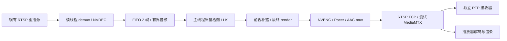

# my-server 实时卡顿修复

起点：`dd9f560a801d3bc2ab8e5fa3b194b20d81d02d59`。实验分支：`feature/my-server-live-stall`。
授权范围仅为 my-server 的独立测试栈，不访问 gpu-server，不修改重播推流器。

## 验证顺序

1. 固定真实部署与恢复资料，核对模块及 GPU 后端。
2. 同时接收 rfm-01/02 原流、完整脱敏输出，记录真实 RTP 完帧间隔、时间轴进度和播放器渲染。
3. 用隔离内部接收端运行无模型媒体链路，定位媒体成本。
4. 开启局部诊断，按主线程非重叠时间定位；单变量修复后复测，撤销无效修改。
5. 关闭诊断，验证持续积压、AAC/PTS/RTCP、遮挡与恢复；未完成项目明确记录。

## 初始部署（2026-11-03，UTC+8）

- 远端仓库：`/data/nvme1n1/zhanjh/hos-vision-shield-test`，HEAD 为起点提交；47 个已安装 Python 模块逐一与 Git blob 的 SHA256 一致。
- Python 3.12.15、PyTorch 2.14.1+cu130、CUDA 13.0、驱动 580.173.02；架构包含 sm_120，PyAV 19.0.1 / libavformat 63.1.102。
- quality_yolo：YOLO 人脸 + EgoBlur Gen1 车牌，YuNet/HyperLPR 补充；CUDA 推理，主车牌使用已有 FP16 路径。
- 项目绑定 GPU 4（UUID `GPU-ec9780c6-4e06-f44a-8491-e30f0ab74da9`），该卡也有其他进程。其他 7 张卡及其他服务不停止。
- 原有测试任务 `b30876a1-3c3f-4eaa-a3e6-90126ad6056e` / `08e5adc2-b8aa-4fce-9893-d8f8cc979d68` 分别使用 rfm-01/02；mosaic、interval=3、flow、5 Mbps、audio_enabled=false。此设置不能充当音视频验收。
- DEBUG=false，FIFO=2，前视 0.5 秒/16 帧及 0.75 秒 wall deadline；输出 100ms interleave，Pacer 已取消迟到重设。

## 恢复

初始状态、完整任务参数和源码指纹保存在服务器 `data/diagnostics/my-server-20261103/`；带私密字段的任务快照权限为 0600，不提交 Git。
原镜像已额外固定为 `vision-shield-test:baseline-20261103-cpu` 和 `vision-shield-test:baseline-20261103-cu130`，后续构建不会覆盖这些名称。
原 `.env.compose.test` 在更改前备份；恢复时还原该文件和起点提交，通过现有 Compose 测试栈入口恢复，或将上述固定镜像重新标记为 `vision-shield-test:cpu/cu130` 后 `up -d --no-build`。

原始视频、包载荷及凭据不提交 Git。mux 返回、RTP 完帧和播放器渲染分别计量，不互相替代。

## 已确认并修复

| 原因 | 独立证据 | 修复 |
|---|---|---|
| 单卡主模型与补充模型的交错执行增加关键路径等待 | 同内容 400 帧实际 RTP 对照：交错 42.544 s、串行 20.264 s；400 帧均收到 | 删除质量检测器的单 worker 主模型线程池，在调用线程按顺序执行；detail 内部脸/牌调度保持原样 |
| Gen1 backbone 的大量小算子提交成本 | 单次诊断中 1695 个 kernel，kernel 总计约 6.53 ms；1575 次 launch 在 profiler 下约 16.08 ms。此诊断不作为 FPS 验收 | 固定形状 backbone 用 CUDA Graph 重放；动态 proposals、NMS、阈值、模型权重不变；缓存最多两种形状，其他形状保留原路径 |
| RTSP 的 100 ms 交织限制按媒体 DTS 判断 | 原流部分连续包仅递增 5～6 个 90 kHz tick；同帧已 mux 后仍滞留 2.414 s | 降低 RTSP 交织阈值，并在每个视频包 mux 后释放已接受的交织包；保持单一 mux owner |
| 原版 PyAV 无显式交织 flush 接口 | 模型暂停 750 ms 时，已完成画面到真实 RTP 的等待达到约 791 ms | 测试 Docker 给固定 PyAV 19.0.1 增加 `flush_mux()`，调用 FFmpeg 的 NULL-packet interleaver flush，保留其异常、超时、关闭保护。按官方配置用 Cython 3.3.0 完整重建绑定，FFmpeg 9.0.2 库不更换 |
| MediaMTX 默认以接收时间替换媒体绝对时间 | 积压时 SR 映射产生数秒变化 | 测试栈启用 `useAbsoluteTimestamp`，保留发送端映射 |
| 保留真实 SR 后，gortsplib 对延迟媒体外推加入时 RTP-Info | 新加入的 FFmpeg 客户端出现视频约 47661 s、音频约 536810 s 的初始时间 | 仅对与 wall time 相差超过 1 s 的媒体省略推测的 RTP-Info 时间戳；包的 RTP/PTS/SR 不变 |
| 健康输出后输入中断仍固定等一次重试 | worker 源码和重试测试 | 已持续确认输出的 source_read/source_decode 中断立即重试一次；未健康、发布错误及连续失败仍指数退避 |

普通 Docker 构建仍选择原 `runtime`，只有 `compose.test.yaml` 选择含 PyAV 补丁的 `rtsp-test`。原版 PyAV 仍能运行 1 μs 的有界交织路径；完整显式 flush 需要测试镜像。

## 独立对照（已完成部分）

- 无模型媒体控制只向容器 loopback 的内部 RTSP peer 发送，保留解码、前视、编码、AAC 和真实 RTP 接收，未公开发布未脱敏画面。
- CUDA Graph 的同内容 400 帧 RTSP 对照：原路径 52.005 s，候选 36.291 s；输入 VCL 顺序一致，400 个实际 RTP 视频帧全部收到。仍有明显吞吐缺口，不能据此宣布 25 FPS 达标。
- 压缩 PTS 的真实 RTP 回归：100 ms 控制最大间隔 1.062 s，1 μs 路径 0.094 s；各 100 帧且保留原 PTS，已收到的 AAC 载荷逐包一致。
- 模型暂停的真实 RTP 回归：已完成画面的 mux→接收等待从 790.9 ms 降到 0.45 ms；模型本身暂停期间仍会缺少新画面，不将这段等待伪装成已解决。
- 线上完整重采 `flush-confirmation`：1617 个视频 access-unit 哈希逐一关联到主线程、容器出口和独立接收器。mux 开始→出口 P99 **0.944 ms**、max **1.626 ms**；mux 返回→出口 P99 **0.090 ms**、max **1.282 ms**；出口→接收 P99 **1.825 ms**、max **5.359 ms**。修复前同帧 mux 返回→出口 P99 约 **1.976 s**、max **2.414 s**。
- 此次 180 s 的独立输出共收到 2480 帧，间隔 >200/500/1000 ms 为 152/14/1；原流为 4317 帧、15/12/6。两条链路内容存在积压时移，此表是窗口观测，不把两条同时 wall-time 曲线当成同内容因果对照。

## 质量和完整性

rfm-01 的 2208 帧、rfm-02 的 2230 帧：新旧模型路径的脱敏 YUV 与 PTS 逐帧一致，各含 22 次主动制造的不完整前视释放及 EOF 尾部。完整 PyAV 重建后重新测试，两个视频的最终序列 digest 也与重建前完全一致。没有更改脸/牌阈值、覆盖、目标身份、LK 或前视窗口。

19 项实际 RTSP/AAC 回归通过，另有本地单元测试；具体结果及最终长时间测试在验收记录中补齐。两个独立控制都确认既有问题：RTSP 关闭时最后一个 AAC AU 没有发出（8000 Hz、1024 样本，即 128 ms）。已收到的连续前缀完整且逐包一致，**不把该缺口称为 AAC 完整性通过**。

## 当前尚未通过的门槛

串行修复后持续处理能力仍低于源的健康供帧速率。共享 GPU 4 的双流正式复核见下表；按用户选择继续使用该卡，没有停止其他任务。局部诊断中 653 个同帧匹配的源接收→应用解码延迟为 46.8～58.4 s，积压尚未解决。源媒体服务器已有慢读丢帧和超时证据；应用 `dropped_frames=0` 不证明源端到播放器无丢帧。

两形状图缓存的辅助 RTSP 统计为 823 次 hit、2 次 capture、58 次 eager 回退；回退约占 6.6%，没有扩大缓存掩盖瓶颈。单线程实验无稳定收益，未保留。同帧 detail 复用早期版本已撤销；在 graph+flush 后重测有小幅收益，尚未作为已验收修复合入。

正式复核使用 DEBUG=false，并分别保留真实 RTP、RTCP、worker 资源及 FFplay 的 A-V、队列和 fd 状态。FFplay 实际窗口单独观察；状态时钟不是逐帧渲染计数，RTP 到达不替代成功显示。

## 无效实验和证据边界

- 单模块 PyAV 扩展通过两个小测试后，在全量回归中崩溃；从未部署。改为官方 Cython 版本、limited API、共享 Cython 模块及完整绑定重建，19 项回归与实际 GPU 链路通过。
- JIT freeze、ORT CUDA Graph、显式 ORT stream、不同卷积算法、单线程和 GPU 调整没有足够收益，或产生数值变化，没有保留。
- 部分早期辅助硬解实验使用了与该驱动不兼容的单卡容器映射；失败样本不用于吞吐收益。后续与正式栈一致使用 all 映射及显式 CUDA UUID。
- 第一轮 `flush-diagnostic` 的大部分诊断响应超过采集器 512 KiB 预算，只有 97 个完整同帧匹配。`flush-confirmation` 将响应预算限定为 2 MiB，并只保留最近四个 attempt，重新完整采集；不把前轮缺口算成通过。
- 旧版 `wire-fixed-*` 是用户态 sniffer 时间，不能用于精确计算单向网络时延。最终同帧使用内核 `SO_TIMESTAMPNS`，并限制在同一主机时钟身份。

## 构建源码缓存

该机直连 Go 代理及大源码归档曾超时，`.env.compose.test` 使用可达的 Go 代理和 loopback 上的已校验 FFmpeg 归档。归档 SHA256 为 `6e374ed621e48faa40639307dff48ba6fe574a509977956d2cce9669b7cc27e9`，Docker ADD 仍强制校验；最终链接的 FFmpeg 库来自原 PyAV wheel。

loopback 缓存目录是服务器 `data/diagnostics/my-server-20261103/build-source-cache/`，端口及 PID 在其中的 `server.json`。需要重建且缓存服务已退出时，可在该目录用标准库 `python3 -m http.server <原端口> --bind 127.0.0.1 --directory <该绝对目录>` 恢复服务，再使用原部署入口。移除 `FFMPEG_SOURCE_URL` 即回到官方源 URL。回退不需要此构建缓存，可直接使用初始固定镜像。

参考：[FFmpeg 交织队列](https://github.com/FFmpeg/FFmpeg/blob/master/libavformat/mux.c)、[AAC RTP 封装](https://github.com/FFmpeg/FFmpeg/blob/master/libavformat/rtpenc_aac.c)、[MediaMTX 绝对时间](https://github.com/bluenviron/mediamtx/blob/main/docs/2-features/15-absolute-timestamps.md)、[固定 gortsplib RTP-Info 实现](https://github.com/bluenviron/gortsplib/blob/v5.6.7/server_stream_format.go)、[PyAV 官方构建配置](https://github.com/PyAV-Org/PyAV/blob/v19.0.1/setup.py)。

## 本轮 600 秒双流复核（2026-11-03，UTC+8）

按用户要求，从**首次启动时间累计 600 秒**，没有重新计时。原先的 1800 秒进程由额外的绝对截止控制器收紧，停止前验证 PID 和命令身份，只结束本轮采集器及播放器。原记录和失败日志均保留。

| 项目 | 实际开始 | 实际停止 / 最后样本 | 覆盖 |
|---|---|---|---|
| 本轮统一周期 | 16:18:50.544 | 截止 16:28:50.544；服务器完成停止 16:28:50.591 | 600 秒，停止动作晚约 47 ms |
| 两路原始/脱敏 RTP 接收 | 16:22:09.150 | 截止同上 | 401.394 秒；首次启动缺少 PYTHONPATH，未产生有效 RTP 样本 |
| FFplay | 16:22:20.129 | 最后状态 16:28:50.517；关闭 16:28:51.131 | 有效日志约 390.389 秒；初次启动误用 Windows Python 别名 |
| 主资源采集 | 16:18:50.626 | 最后样本 16:28:45.897；16:28:50.591 停止 | 120 个 5 秒采样点，采集进程覆盖统一周期 |

**不能将本轮称为完整的 10 分钟 RTP 或播放器观测。** 起始约 199 秒的 RTP 缺口不计为流冻结，也没有通过补测延长截止时间。

部署代码为 `4de6dd939d47a20756650964aabaac529b974356`，标签 `cand-20261103-myserver-serial-02`，DEBUG=false。API 与三个 stream worker 的 48 个已安装 Python 模块均与该提交逐项 SHA256 一致；原生 PyAV 输出模块 SHA256 为 `df08bff3a5286db1d07155eb4bbcabca640fe94211e8b5d47bc380ca8e7f0672`，实际存在 `flush_mux()`。

| 接收流 | 视频帧 | 平均 FPS | 间隔 P50 / P95 / P99 / max（ms） | >200 / 500 / 1000 ms | 1 秒 / 5 秒窗口 FPS 中位数 |
|---|---:|---:|---|---|---|
| rfm-01 原始 | 9699 | 24.16 | 0.225 / 159.73 / 161.31 / 3021.19 | 29 / 25 / 13 | 25 / 24.8 |
| rfm-01 脱敏 | 7353 | 18.32 | 25.91 / 168.64 / 325.05 / 8006.18 | 268 / 23 / 1 | 14 / 13.4 |
| rfm-02 原始 | 9981 | 24.87 | 0.230 / 160.39 / 161.40 / 886.41 | 18 / 13 / 0 | 25 / 24.8 |
| rfm-02 脱敏 | 5574 | 13.89 | 54.41 / 181.35 / 289.57 / 8390.98 | 209 / 9 / 2 | 13 / 12.4 |

平均 FPS 的分母为统一有效 RTP 观测窗 401.394 秒；窗口 FPS 每 100 ms 滑动，包含该有效观测窗内的恢复空窗。两路脱敏的 1 秒和 5 秒最低窗口均为 0。此表为同时观测，输出有积压，不能将同 wall-time 的原流/输出冻结数量当作同内容因果对照。

原文件首个 VCL 帧哈希标识循环：rfm-01 捕获 4 次循环起点，间隔约 91.9 秒；rfm-02 捕获 5 次，间隔约 89.8 秒。因此记录约 5 次循环的短测覆盖，**不作长期稳定性通过结论**。

GPU 4 利用率中位数 88%、P95 93%（含其他任务）；两个活动 worker 的 CPU 中位数约 231%、229%，空闲 worker 约 0.36%。未停止其他进程。此前局部诊断的非重叠主线程为 rfm-01 60.49 ms/帧、rfm-02 93.50 ms/帧，其中主车牌 19.15/31.76 ms、detail 车牌 8.98/13.70 ms；没有将异步模型耗时与 future 等待重复相加，当前质量主路径已无 primary future。

最终同帧诊断匹配 1215 帧，mux 开始→内核出口 P99 0.795 ms、max 1.156 ms，出口→独立接收 P99 1.847 ms、max 13.464 ms。原先已完成画面在 mux 后滞留 1～2 秒的问题已修复；剩余多秒空窗伴随输入连接恢复，不能以 mux 修复替代整个流畅性验收。

本轮公开状态记录 rfm-01 一次 recovering/connecting→running、rfm-02 两次 connecting→running，采样到的恢复状态窗约 2.4～3.0 秒；这不是完整的故障→首个实际 RTP 时长。实际 RTP 最大空窗仍为 8.0/8.4 秒，EOF 前的积压、解码/读取及恢复总延迟尚未闭环解决。

FFplay 共 3 次连接，记录 11114 个状态点，fd 最大值 0；绝对 A-V 中位数 0.138 s、P95 0.320 s、P99 0.527 s、max 3.755 s，约 63.8% 状态点视频队列为空。状态日志仍显示缓冲/恢复问题，不能宣布音画同步或播放器流畅性通过。本轮电脑操作收到用户 Esc 停止信号后没有再次操作窗口；播放器状态时钟不能当作逐帧渲染证明。

本轮输出每个连接内的视频和 AAC RTP 时间戳均无倒退、无相同时间戳，接收端未发现 RTP sequence gap。输出 SR 的连续映射残差最大约 98.1 μs；这证明映射连续，不能据此否认播放器实际出现的 A-V 偏差，也不能证明 EOF 时最后一个 AAC AU 已发送。

串行版本重新比较 rfm-01 的 2208 帧、rfm-02 的 2230 帧，完整脱敏 YUV+PTS digest 与旧路径完全相同（含各 22 次强制不完整前视释放和 EOF）。本地全量单元测试 **980 passed、96 skipped**；GPU 质量比较和真实 RTSP 回归分别记录，不把这些 skip 宣称为通过。已确认的最后一个 AAC AU 尾部缺口仍未修复。

停止采集后，以下替代任务仍 `running/ready`，音频开启、5 Mbps；原先无音频任务已停止，未修改源流或推流器：

- rfm-01：`1aed319f-e680-4f52-ad70-cd9b0be0a220`
- rfm-02：`e9d6a3ab-3843-48f4-8083-7dc8f89759b1`

结论：保留已验证的 graph、串行调度、mux flush、RTCP/RTP-Info 和重试修复；**25 FPS、持续积压、剩余恢复空窗、完整 AAC 尾部和本轮逐帧播放渲染验收尚未通过**。

机器可读结果：[600 秒采集与停止证据](evidence/serial-round-600.json)、[播放器](evidence/player-600.json)、[循环标识](evidence/serial-cycle-markers.json)、[同帧时间线与关键路径](evidence/serial-timeline.json)、[rfm-01 质量](evidence/serial-quality-rfm01.json)、[rfm-02 质量](evidence/serial-quality-rfm02.json)。完整原始采集位于 my-server 的 `data/diagnostics/my-server-20261103/serial-formal-rfm01/`、`serial-formal-rfm02/`，其中清单保留文件大小和 SHA256；播放器原日志在本地同诊断目录的 `player-serial-final/`。回退方式见上文，main 未合并。
